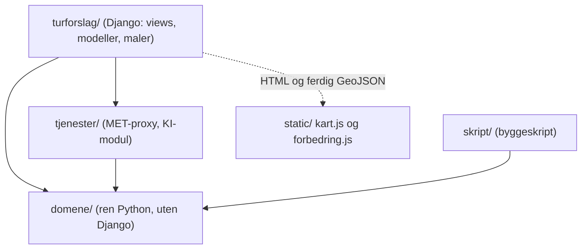
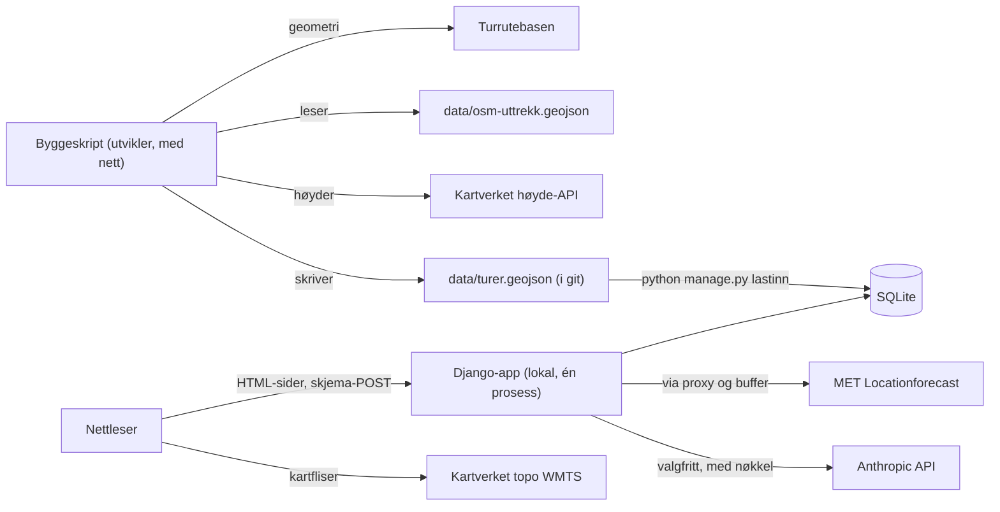
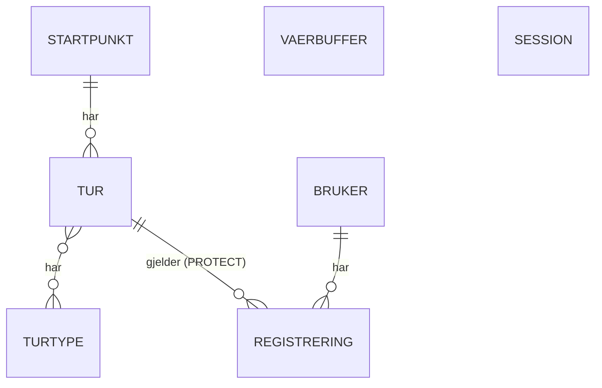
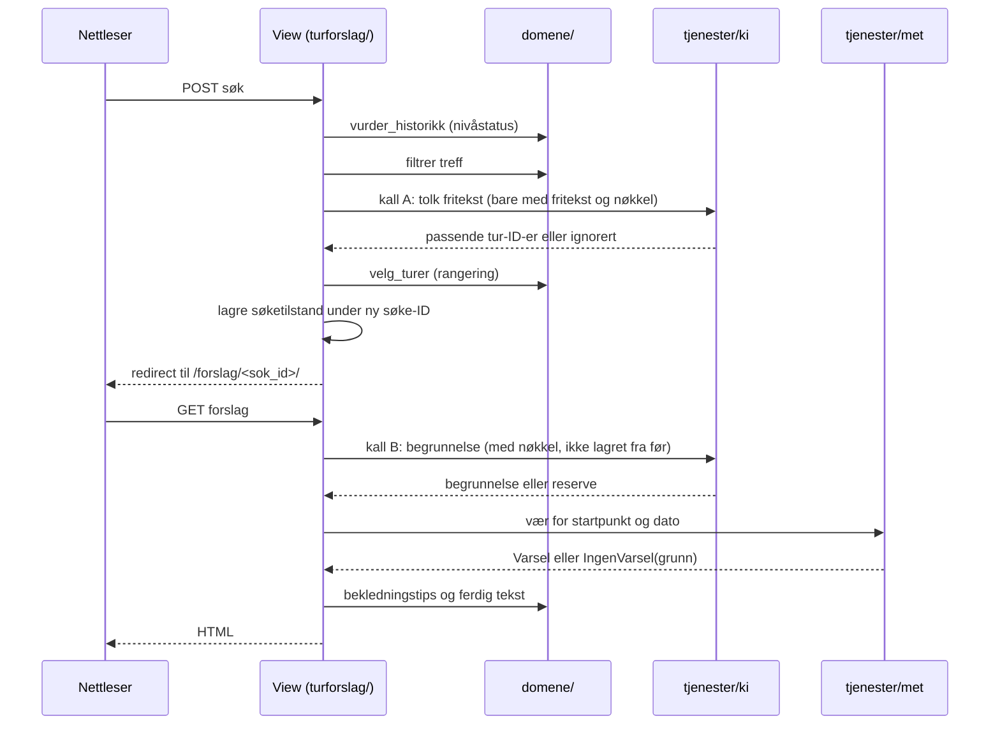

# Architecture Spine — Your Next Adventure

## Design Paradigm

**Lagdelt server-rendret monolitt.** Én Django-prosess renderer alle sider med Django-maler. Inne i monolitten er det fire lag, og hvert lag er én mappe:

| Lag | Mappe | Innhold | Kan importere |
| --- | --- | --- | --- |
| Web | `turforslag/` | Django-app: URL-er, views, skjemaer, modeller, maler, statiske filer (Leaflet, `kart.js`, `forbedring.js`, CSS) | `domene/`, `tjenester/` |
| Domene | `domene/` | Ren Python: turdatatypen, gradering, tidsestimat, utvalg og rangering, nivåstatus, turtypepreferanse, bekledningstips, KI-validering, tekstmaler og formatering | bare standardbiblioteket |
| Tjenester | `tjenester/` | Adaptere mot omverdenen: MET-proxy og KI-modul | `domene/` |
| Bygg | `skript/` | Byggeskriptet for turdatabasen, kjøres utenfor appen | `domene/` |



Pilene viser hvem som får importere hvem. `domene/` importerer aldri Django, `tjenester/` eller `turforslag/`.

## Invariants & Rules

### AD-1 — Én server-rendret Django-monolitt, JavaScript bare som forbedring [ADOPTED]

- **Binds:** all
- **Prevents:** at deler av appen bygges som SPA/API med eget frontend-rammeverk, at sensor må installere Node eller kjøre flere prosesser, og at logikk havner i nettleseren.
- **Rule:** Alle sider renderes på serveren med Django-maler, i én prosess. Det finnes nøyaktig to egne JavaScript-filer, begge uten rammeverk og byggesteg: `kart.js` (AD-8) og `forbedring.js`. `forbedring.js` gjør bare det `EXPERIENCE.md` beskriver: «Nytt forslag» uten sideinnlasting (henter et HTML-fragment fra serveren og setter `document.title`, fokus og `aria-busy`), lasteindikator, sperre mot dobbeltklikk, tegnteller og «Vis passord». Alle sider og skjemaer virker fullt uten JavaScript. Serveren svarer med HTML, aldri JSON, til egne sider.

### AD-2 — Domeneregler ligger i `domene/` som ren Python [ADOPTED]

- **Binds:** FR-2, FR-3, FR-5, FR-8, FR-9, FR-12, FR-13, FR-17.1, FR-18, FR-19, FR-20, NFR-6, SM-2
- **Prevents:** at regler spres i views, modeller, maler eller JavaScript, og at samme regel får to implementasjoner som gir ulike svar.
- **Rule:** Hver regel finnes som én funksjon i `domene/` som tar dataklasser eller vanlige verdier inn og gir verdier ut, uten database, nettverk eller klokke (dagens dato sendes inn). `domene/` importerer ikke Django. Views og byggeskript kaller disse funksjonene og regner, filtrerer eller formaterer ikke selv. Utvalget gjøres av én funksjon, `velg_turer`, som returnerer `Utvalg(status, rangerte_tur_ider)` der `status` er én av `TREFF`, `TOPPTUR_ERSTATTET`, `BARE_OVER_NIVATAK`, `INGEN_TREFF` (FR-5, FR-8). Hver regel har enhetstester som viser til FR-ID-en.

### AD-3 — Turdatabasen bygges på forhånd og har én kilde og én datatype [ADOPTED]

- **Binds:** FR-1, FR-2, FR-3, FR-6, FR-21, NFR-1, NFR-7
- **Prevents:** at appen henter turdata mens den kjører, at felt og enheter tolkes ulikt av byggeskript, lasting og visning, og at ny lasting sletter brukeres historikk.
- **Rule:**
  1. **Datatype:** `domene.tur.Tur` er en frossen dataklasse og eneste beskrivelse av en tur. Den har `til_geojson_feature()` og `fra_geojson_feature()`. Felt (lagres for **én vei** ved tur-retur; totaler beregnes bare av funksjoner i `domene.tur`):

     | Felt | Type og enhet |
     | --- | --- |
     | `id` | streng, stabil, fra kurateringslista (`granvann-rundt`) |
     | `navn` | streng, håndskrevet |
     | `startpunkt_id`, `startpunkt_navn` | streng |
     | `startpunkt_lat`, `startpunkt_lon`, `startpunkt_hoyde_m` | desimaltall (WGS84), heltall meter |
     | `form` | `rundtur` eller `tur-retur` |
     | `turtyper` | liste av `marka`, `utsikt`, `topptur` |
     | `lengde_m`, `hoydemeter_m`, `nedstigning_m` | heltall meter |
     | `hoydeprofil` | liste av `[avstand_m, hoyde_m]` |
     | `turniva` | `gronn`, `bla`, `rod`, `svart` (FR-2: én vei for tur-retur, hele runden for rundtur) |
     | `estimert_tid_min` | heltall minutter for hele turen (FR-3) |
     | `ut_no_url` | streng eller tom |
     | `kilde`, `lisens` | streng (`turrutebasen`/`osm`; `CC BY 4.0`/`ODbL`) |
     | `geometry` | GeoJSON `LineString` i WGS84 |

     Feltnavnene her erstatter navnene i addendumet.
  2. **Bygging:** Kurateringslista i `data/` gir id, navn, startpunkt, form, turtyper, kilde-ID og ut.no-URL. Turnavnet hentes aldri fra kilden. `skript/bygg_turdatabase.py` (kjøres med `python -m skript.bygg_turdatabase`) henter geometri, henter høyder (Kartverket, maks 50 punkter per kall, punkt hvert 10–25 m, støyfiltrering), gjør om UTM (EPSG:25832/25833) til WGS84 med `pyproj`, beregner verdiene via `domene/` og skriver `data/turer.geojson`, som committes.
  3. **OSM (ODbL):** OSM-geometri hentes én gang til `data/osm-uttrekk.geojson` (committet, med ODbL-kreditering), og byggeskriptet leser den fila, ikke OSM. Skriptet stopper hvis uttrekket har 100 objekter eller flere.
  4. **Lasting:** `python manage.py lastinn` leser `turer.geojson` og `data/testbruker.*` inn i SQLite. Turer oppdateres eller opprettes etter `id`, aldri slettet og gjenopprettet. `Registrering.tur` har `on_delete=PROTECT`; mangler en tur med registreringer i fila, stopper kommandoen med en melding. Testbrukeren slettes og lages på nytt fra fil ved hver kjøring.
  5. Geometri og høydeprofil lagres i `JSONField`. Ingen GeoDjango eller SpatiaLite.
  6. Appen beregner aldri turnivå, høydemeter eller estimert tid på nytt.

### AD-4 — SQLite og Djangos ORM er eneste lagring [ADOPTED]

- **Binds:** all
- **Prevents:** databaseserver som sensor må installere, og rå SQL eller databasespesifikke funksjoner.
- **Rule:** All persistent tilstand (turer, brukere, registreringer, økter, værbuffer) ligger i én SQLite-fil via Django-modeller og migreringer. Ingen rå SQL. Databasefilen committes ikke.

### AD-5 — Hvert søk har en søke-ID og lever i Django-økten [ADOPTED]

- **Binds:** FR-5, FR-7, FR-8, FR-12, FR-14, FR-17
- **Prevents:** delbare turforslag, at faner overskriver hverandres forslag, at reload kaller KI på nytt eller endrer rangeringen, at økten lagres feil eller tømmes ved et uhell, og at gjestens forslag forsvinner ved innlogging.
- **Rule:**
  1. Et gyldig søk (POST) lager en tilfeldig søke-ID og sender videre til `/forslag/<sok_id>/`. Søket står aldri i URL-en, bare ID-en.
  2. Tilstanden lagres i Django-økten (databasebasert) under nøkkelen `"sok"`, som er en ordbok `sok_id → Soketilstand`. `domene.okt.Soketilstand` er en dataklasse med `til_dict()` og `fra_dict()` (datoer som ISO-strenger): søket, `rangerte_tur_ider` (frosset ved søket), `viste_tur_ider`, `gjeldende_tur_id`, `nivaheving` (AD-11), KI-tolkningen og begrunnelsene per vist tur (AD-10).
  3. Bare `turforslag/okt.py` leser og skriver `"sok"`, og den skriver alltid hele verdien på nytt. Den beholder de 10 nyeste søkene.
  4. Reload, «Nytt forslag» og «Start fra første forslag igjen» leser rangeringen fra økten og rangerer ikke på nytt. En ukjent søke-ID, eller en tur-ID som ikke lenger finnes, gir «Forslaget finnes ikke lenger».
  5. Ingen kode kaller `flush()`, `cycle_key()` eller `clear()` på økten. Bare Djangos `login()` (beholder data) og `logout()` (tømmer alt) endrer økten slik.
  6. Registrering tar tur-ID fra URL-en (`/registrer/<tur_id>/`), aldri fra økten.

### AD-6 — Innlogging varer i to uker uten kort inaktivitetsgrense [ADOPTED]

- **Binds:** FR-14, NFR-4 (WCAG 2.2.1)
- **Prevents:** at brukeren logges ut midt i en registrering og mister det hen har fylt inn.
- **Rule:** `SESSION_COOKIE_AGE` beholder Djangos standard (1 209 600 s). Ingen inaktivitetsutlogging. Utlogging er en synlig knapp (POST). Er innloggingen likevel utløpt, sendes brukeren til Logg inn med `next` og tilbake til samme side.

### AD-7 — Konto: egen brukermodell med e-post, Django-auth for resten [ADOPTED]

- **Binds:** FR-14, FR-15, NFR-5, NFR-8
- **Prevents:** at brukermodellen må byttes etter første migrering, egenskrevet passordhåndtering, og at en bruker ser andres data.
- **Rule:** `turforslag.Bruker` arver `AbstractUser` med `username=None`, `first_name`/`last_name` fjernet, `USERNAME_FIELD="email"` og egen manager; den finnes i første migrering. E-post lagres med små bokstaver. Feltet `brukt_heving` (heltall, standard 0) brukes av AD-11. `AUTH_PASSWORD_VALIDATORS` har bare minimumslengde 8. Sider med brukerdata krever innlogging og henter data filtrert på `request.user`. Kontosletting går i denne rekkefølgen: slett brukeren og registreringene i én transaksjon → `logout()` → kvitteringsmelding → redirect. Feiler transaksjonen, slettes ingenting.

### AD-8 — Kart: Kartverket topo + vendret Leaflet, kart uten logikk [ADOPTED]

- **Binds:** FR-6, NFR-3, NFR-4, NFR-7
- **Prevents:** forretningslogikk i nettleseren, CDN- eller npm-avhengighet, og kartfliser som krever nøkkel.
- **Rule:** Fliser hentes fra `https://cache.kartverket.no/v1/wmts/1.0.0/topo/default/webmercator/{z}/{y}/{x}.png` uten nøkkel, zoom høyst 18. Leaflet ligger i `static/vendor/leaflet/`. `kart.js` får ferdig GeoJSON for én tur fra malen og tegner den; den filtrerer, beregner eller henter ingenting annet. Turillustrasjonen og høydeprofilen (FR-6) lages som inline SVG på serveren, ikke i JavaScript. «Kartet i tekst» lages fra turdata av `domene/`.

### AD-9 — Værdata går via en bufrende proxy i `tjenester/` [ADOPTED]

- **Binds:** FR-9, FR-10, NFR-1, NFR-7
- **Prevents:** at nettleseren kaller MET, brudd på MET-vilkårene, og at et MET-avbrudd stopper turforslaget.
- **Rule:** Bare `tjenester/met.py` kaller MET Locationforecast. Koordinater rundes til 4 desimaler, og startpunktets høyde sendes som `altitude`. Bufferen (Django-modell) lagrer svar, `Expires` og `Last-Modified` per avrundet koordinat; nytt kall skjer først etter `Expires`, med `If-Modified-Since`. User-Agent kommer fra `MET_USER_AGENT`. Tidsavbrudd 5 s. Tjenesten returnerer `Varsel` (timeverdier) eller `IngenVarsel(grunn)` der `grunn` er `FOR_LANGT_FREM` (datoen er utenfor varselet, i praksis mer enn 9 dager frem) eller `UTILGJENGELIG`. Bekledningstips lages av en ren regel i `domene/` fra timeverdiene kl. 10–16 Europe/Oslo.

### AD-10 — KI-modulen har ett grensesnitt, tre varianter og en fast kallrekkefølge [ADOPTED]

- **Binds:** FR-11, FR-12, FR-13, FR-17, NFR-1, NFR-5, NFR-8, SM-2, SM-3
- **Prevents:** at kjerneflyten avhenger av en nøkkel, at KI velger turer utenfor treffene eller skriver tall og nivå, at personopplysninger sendes ut, at tester krever nett, og at ulike stories kaller KI ulikt.
- **Rule:**
  1. Views kaller bare KI-grensesnittet i `tjenester/ki/`. Variantene er **ekte** (Anthropic), **reserve** (FR-13) og **falsk** (tester). Uten `ANTHROPIC_API_KEY` brukes reserve.
  2. **Kall A, tolking (FR-11):** én gang per gyldig søk, bare når det finnes fritekst og nøkkel, før rangeringen. Svar: hvilke av de filtrerte tur-ID-ene som passer ønsket.
  3. **Kall B, begrunnelse (FR-12):** én gang per tur som vises i søket, når nøkkel finnes, med eller uten fritekst. Svar: begrunnelse med plassholdere. Lagres i søketilstanden (AD-5), så reload ikke kaller på nytt.
  4. Turforslag fra historikken kaller aldri KI (FR-17).
  5. KI får bare søket (varighet, dato, turtype, startpunkt, fritekst) og de filtrerte treffene (id, navn, turtyper, form). Aldri e-post, bruker-ID eller historikk. Fritekst legges i prompten som avgrenset data, ikke som instruksjoner. Prompten ligger i en fil i `tjenester/ki/` og versjoneres i git.
  6. Ekte klient: `timeout=5.0`, `max_retries=0`, lav effort, ingen sampling-parametere og ingen prefill.
  7. Hvert svar valideres av `domene/` (FR-13): ID-er innenfor treffene, bare plassholderne `{tid}`, `{varighet}`, `{lengde}`, `{nivå}`, ingen sifre, tallord eller nivåord utenfor dem, maks 300 tegn etter innsetting og med personaliseringssetningen. Forkastes kall A, ignoreres friteksten for hele søket. Forkastes kall B, brukes reservemalen for den turen.
  8. Forkastede svar logges med svar og årsak, uten fritekst, e-post eller bruker-ID.

### AD-11 — Nivåstatus utledes av historikken i én funksjon

- **Binds:** FR-5, FR-8, FR-12, FR-17.1, FR-18, FR-19, FR-20, FR-21, SM-C1
- **Prevents:** at lagret nivå og historikk kommer i utakt, og at søk, fremgang og begrunnelse teller historikken ulikt.
- **Rule:**
  1. `domene.niva.vurder_historikk(registreringer) → NivaStatus` er eneste kilde til nivåtak, sperre, antall hevinger så langt, fremgang mot neste nivå og foretrukne turtyper. Registreringer behandles i rekkefølge (dato, deretter registrerings-ID). Ingen registreringer gir grønt nivåtak.
  2. **Nivåheving i rangeringen (FR-5 punkt 2.3)** avgjøres bare ved et gyldig søk: er `NivaStatus.antall_hevinger > bruker.brukt_heving`, får søket `nivaheving=True` i søketilstanden, og `brukt_heving` settes til `antall_hevinger`. Ellers `False`. Gjester har alltid `False`. At en sperre oppheves, er ikke en heving. Heving regnes som brukt selv om søket gir ingen treff.
  3. `lastinn` setter testbrukerens `brukt_heving` til én mindre enn antall hevinger, så demoen viser hevingen i første søk.
  4. Rangeringen ender alltid med tur-ID som siste avgjører.

### AD-12 — Lokal kjøring etter README, uten ekte nøkler [ADOPTED]

- **Binds:** NFR-1, NFR-6, sensor kriterium 5
- **Prevents:** at sensor må ha nøkler, Node, Docker eller databaseserver, at hemmeligheter havner i git, og at Django-standarder gir engelske eller feil tekster.
- **Rule:**
  1. Installasjon: `python -m venv`, `pip install -r requirements.txt`, kopier `.env.example` til `.env`, `python manage.py migrate`, `python manage.py lastinn`, `python manage.py runserver`.
  2. `requirements.txt` har låste versjoner og bare det appen trenger; `requirements-bygg.txt` har i tillegg `pyproj`.
  3. `.env.example` virker uten endring: `DJANGO_SECRET_KEY` (en lokal utviklingsverdi), `DEBUG=True`, `ANTHROPIC_API_KEY=` (tom) og `MET_USER_AGENT` med appnavn og repo-URL (ingen personlig e-post). Den leses med `python-dotenv` i `config/settings.py`.
  4. `.gitignore` har `.env`, `venv/`, databasefilen og `logs/`.
  5. Innstillinger: `LANGUAGE_CODE="nb"`, `TIME_ZONE="Europe/Oslo"`, egne norske maler for 404, 500 og CSRF-feil.
  6. README har: krav (Python 3.12–3.15, testet på 3.14), installasjonen over, testbrukerens innlogging, `python manage.py test`, mappeoversikt, hvordan KI-nøkkel legges inn, og lenker til PRD, UX og denne arkitekturen.
  7. Ingen produksjonsdeploy i v1.

### AD-13 — Tester, kodestil og logging

- **Binds:** SM-2, NFR-2, NFR-6
- **Prevents:** tester som krever nett eller nøkler, og ulik formatering.
- **Rule:** Alle tester kjøres med `python manage.py test` og ligger i `tests/`. Domenetester bruker ikke databasen. KI byttes med den falske varianten og MET med lagrede svar i `tests/fixtures/`; ingen test gjør nettverkskall. Ruff er linter og formatter (`pyproject.toml`). Logging bruker Pythons `logging` med én logger per modul; forkastede KI-svar skrives til `logs/ki.log` (lokalt, ikke i git).

### AD-14 — Engangstoken mot dobbel registrering

- **Binds:** FR-16, FR-19, NFR-2
- **Prevents:** at dobbeltklikk eller to samtidige POST-er gir to registreringer og dermed feil nivåheving.
- **Rule:** Skjemaet for «Registrer gjennomført tur» har et engangstoken som lagres i økten når skjemaet vises, og brukes opp ved første gyldige POST. En POST med brukt eller ukjent token lagrer ingenting og sender til historikken. Dette dekkes av en test.

## Consistency Conventions

| Concern | Convention |
| --- | --- |
| Språk i koden | Domenebegreper på norsk som i PRD §3 (`tur`, `turniva`, `nivatak`, `startpunkt`, `registrering`), uten æ/ø/å i identifikatorer. Ellers Python-standard: `snake_case`, `PascalCase` for klasser |
| Tekst i grensesnittet | All brukertekst kommer fra `EXPERIENCE.md` › Mikrotekst og står i maler eller i setningsmaler i `domene/`. Jeg-form, du-tiltale |
| Sporbarhet | Funksjoner, tester og commits viser til FR-/NFR-ID der de oppfyller et krav (f.eks. `# FR-19`) |
| ID-er | Tur-ID og startpunkt-ID er stabile strenger fra kurateringslista. Søke-ID er tilfeldig (`secrets.token_urlsafe`). Brukere og registreringer har Djangos heltall-ID |
| Enheter og formatering | Meter og hele minutter overalt i data. Formatering til «ca. 1 t 35 min», «3,5 km» og «grønn» skjer bare i `domene/` |
| Datoer og tid | `datetime.date` i domenet; dagens dato sendes inn. Tidssone Europe/Oslo |
| Skjema og validering | Django-skjemaer validerer alt på serveren. Alle POST følger Post/Redirect/Get. CSRF er på |
| Feil fra eksterne tjenester | `tjenester/` kaster aldri videre til view; de returnerer typede resultater (`IngenVarsel`, reserve), og visningen viser teksten fra Mikrotekst |
| Konfigurasjon | Miljøverdier leses bare i `config/settings.py` |
| Kreditering | Én felles krediteringslinje i basismalen med «© Kartverket», «© OpenStreetMap contributors» og «Data fra MET Norge», med lenker. Leaflets egen attribution-prefiks er slått av |
| Nettleserstøtte | De to nyeste versjonene av Chrome, Edge, Firefox og Safari, også på mobil. Ingen polyfills |
| Tilgjengelighet | Mønstrene i `EXPERIENCE.md` (komponenter, Accessibility Floor) gjelder for alle maler |

## Stack

| Name | Version |
| --- | --- |
| Python | 3.12–3.15 (utviklet og testet på 3.14) |
| Django | 6.1.3 |
| SQLite | 3.37 eller nyere (følger med Python) |
| anthropic (Python-SDK) | 2.6.0 |
| KI-modell | `claude-haiku-5-5` |
| httpx2 (HTTP-klient, følger med anthropic) | 2.16.0 |
| python-dotenv | 1.2.4 |
| Leaflet | 1.9.4 |
| Kartverket topo WMTS | v1, WMTS 1.0.0 |
| MET Locationforecast | 2.0 |
| Kartverket høyde-API | v1 |
| pyproj (bare byggeskript) | 3.8.0 |
| Ruff (utvikling) | 0.17.4 |

## Structural Seed

### Kildetre

```text
G81-eriksen/
  manage.py
  requirements.txt          # appens pakker, låste versjoner
  requirements-bygg.txt     # i tillegg for byggeskriptet (pyproj)
  pyproject.toml            # Ruff-oppsett
  .env.example
  README.md
  config/                   # Django-innstillinger, rot-URL-er
  turforslag/               # Django-appen: models, views, forms, urls, okt.py
    management/commands/    # lastinn
    templates/              # inkl. 404, 500, CSRF-feil
    static/                 # css/, kart.js, forbedring.js, vendor/leaflet/
  domene/                   # tur, okt, utvalg, niva, tid, gradering, tips, ki_validering, tekst
  tjenester/                # met.py, ki/ (grensesnitt, ekte, reserve, falsk, prompt)
  data/                     # kurateringsliste, osm-uttrekk.geojson, turer.geojson, testbruker
  skript/                   # bygg_turdatabase.py
  tests/                    # domene/, tjenester/, web/, fixtures/
  docs/                     # README-vedlegg, arkitekturforklaring
```

### System og omgivelser



### Kjerneentiteter



### Flyt for ett søk



## Capability → Architecture Map

| Capability / Area | Lives in | Governed by |
| --- | --- | --- |
| FR-1 Turdatabase | `data/`, `skript/`, `lastinn` | AD-3, AD-4 |
| FR-2 Gradering, FR-3 Estimert tid | `domene/` (brukt av `skript/`) | AD-2, AD-3 |
| FR-4 Søkeskjema | `turforslag/` (skjema og mal), `forbedring.js` | AD-1, konvensjon Skjema |
| FR-5 Utvalg og rangering, FR-8 Ingen treff | `domene/` | AD-2, AD-11 |
| FR-6 Visning av turforslag | maler, `kart.js`, SVG fra server | AD-8 |
| FR-7 Nytt forslag og økt | `turforslag/okt.py`, `domene.okt`, `forbedring.js` | AD-1, AD-5 |
| FR-9, FR-10 Vær og bekledning | `tjenester/met.py`, `domene/` | AD-9 |
| FR-11–13 KI | `tjenester/ki/`, `domene/` | AD-10 |
| FR-14, FR-15 Konto | `turforslag/` (Bruker, Django-auth) | AD-6, AD-7 |
| FR-16, FR-17, FR-17.1 Registrering og historikk | `turforslag/`, `domene/` | AD-7, AD-11, AD-14 |
| FR-18–20 Personalisering | `domene/` | AD-2, AD-11 |
| FR-21 Testbruker | `data/`, `lastinn` | AD-3, AD-11 |
| NFR-1 Kjørbarhet | README, `.env.example`, kravfiler | AD-12 |
| NFR-2 Stabilitet, NFR-8 Sikkerhet | alle views | AD-7, AD-14, konvensjon Skjema |
| NFR-3, NFR-4, NFR-9 Mobil, UU, mørk modus | maler, CSS, `forbedring.js` | AD-1, AD-8, `EXPERIENCE.md` |
| NFR-5 Personvern | `tjenester/ki/`, Bruker | AD-7, AD-10 |
| NFR-6 Sporbarhet | all kode og alle tester | AD-2, konvensjon Sporbarhet |
| NFR-7 Kreditering | basismal, `data/` | AD-3, konvensjon Kreditering |

## Deferred

| Utsatt | Hvorfor det kan vente |
| --- | --- |
| Format på kurateringslista og testbrukerfila (CSV, YAML eller TOML) | Bare byggeskriptet og `lastinn` leser dem; avgjøres i første story for turdatabasen |
| Ordlyden i KI-prompten | Kallrekkefølgen og valideringen (AD-10) binder resultatet; ordlyden justeres under implementering |
| Terskler for støyfiltrering (2–10 m) og punktavstand (10–25 m) | Settes når byggeskriptet testes mot publiserte høydeprofiler (FR-1) |
| Kartets zoomgrenser og bevegelser (Ctrl + rullehjul, to fingre) | Løses i kartstoryen med Leaflets innebygde valg etter `EXPERIENCE.md`; ingen plugin uten ny beslutning |
| Om utfylte felt beholdes gjennom ny innlogging | UX-punktet er `[ASSUMPTION]`; avgjøres i kontostoryen |
| Produksjonsdeploy, HTTPS, e-postutsending og passordtilbakestilling | Utenfor v1; sensor kjører lokalt (NFR-1) |
| Leverandørbytte for KI (Gemini Flash-Lite) | Bare hvis Anthropic-startkreditten ikke finnes; krever én ny variant i `tjenester/ki/` (AD-10) |
| Turer utenfor Oslo og Bærum | FR-1 avgrenser v1; dekningen sjekkes per tur hvis lista utvides |
