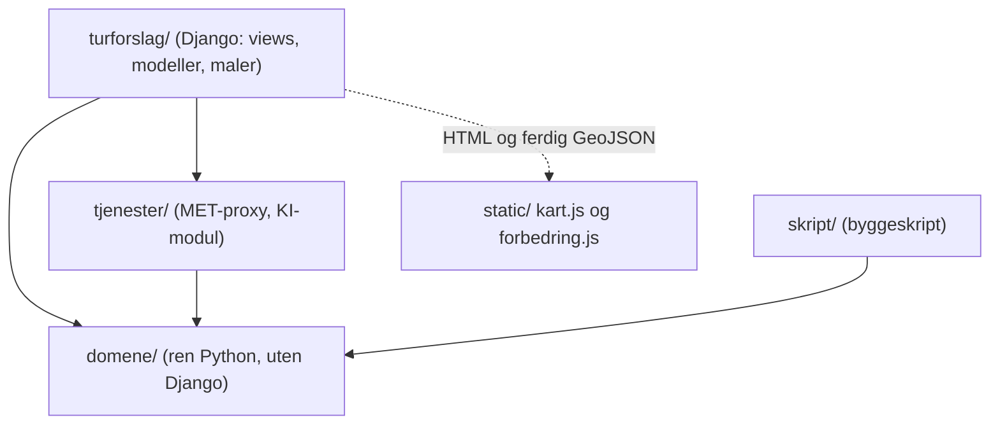
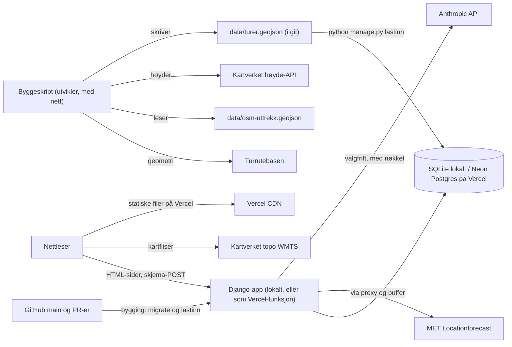
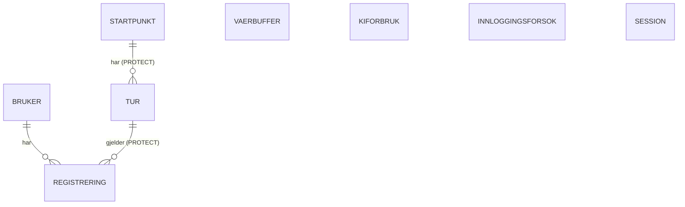
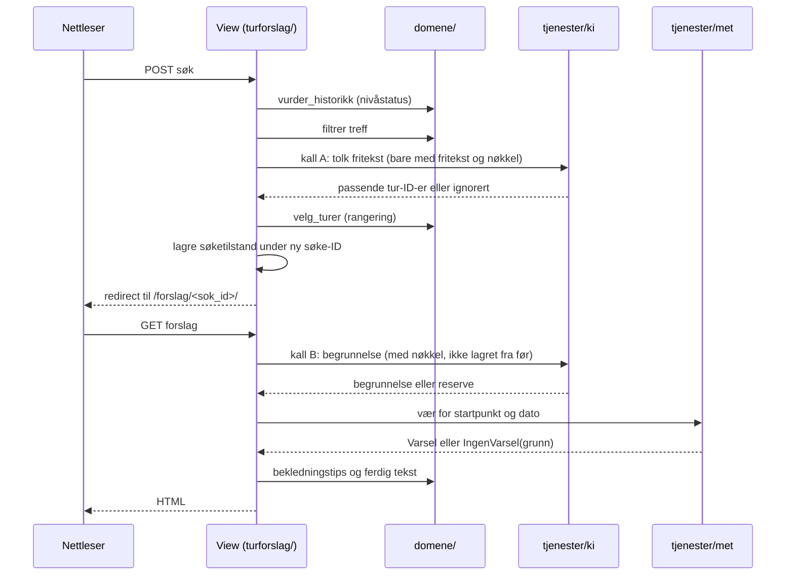

# Architecture Spine — Your Next Adventure

## Design Paradigm

**Lagdelt server-rendret monolitt.** Én Django-prosess renderer alle sider med Django-maler. Inne i monolitten er det fire lag, og hvert lag er én mappe:

| Lag | Mappe | Innhold | Kan importere |
| --- | --- | --- | --- |
| Web | `turforslag/` | Django-app: URL-er, views, skjemaer, modeller, maler, statiske filer (Leaflet, `kart.js`, `forbedring.js`, CSS) | `domene/`, `tjenester/` |
| Domene | `domene/` | Ren Python: turdatatypen, gradering, tidsestimat, utvalg og rangering, nivåstatus, turtypepreferanse, bekledningstips, KI-validering, tekstmaler og formatering | bare standardbiblioteket |
| Tjenester | `tjenester/` | Adaptere mot omverdenen: MET-proxy og KI-modul. Egen Django-app som eier modellene tjenestene bruker (`Vaerbuffer` og `KiForbruk` i `tjenester/models.py`) | `domene/` og Django, aldri `turforslag/` |
| Bygg | `skript/` | Byggeskriptet for turdatabasen, kjøres utenfor appen | `domene/` |



Pilene viser hvem som får importere hvem. `domene/` importerer aldri Django, `tjenester/` eller `turforslag/`.

## Invariants & Rules

### AD-1 — Én server-rendret Django-monolitt, JavaScript bare som forbedring [ADOPTED]

- **Binds:** all
- **Prevents:** at deler av appen bygges som SPA/API med eget frontend-rammeverk, at sensor må installere Node eller kjøre flere prosesser, og at logikk havner i nettleseren.
- **Rule:** Alle sider renderes på serveren med Django-maler, i én prosess. Det finnes nøyaktig to egne JavaScript-filer, begge uten rammeverk og byggesteg: `kart.js` (AD-8) og `forbedring.js`. `forbedring.js` gjør bare det `EXPERIENCE.md` beskriver: «Nytt forslag» uten sideinnlasting (henter et HTML-fragment fra serveren og setter `document.title`, fokus og `aria-busy`), lasteindikator, sperre mot dobbeltklikk, tegnteller og «Vis passord». Alle sider og skjemaer virker fullt uten JavaScript. Serveren svarer med HTML, aldri JSON, til egne sider.

### AD-2 — Domeneregler ligger i `domene/` som ren Python [ADOPTED]

- **Binds:** FR-2, FR-3, FR-5, FR-8, FR-9, FR-12, FR-13, FR-17.1, FR-18, FR-19, FR-20, NFR-6, SM-2
- **Prevents:** at regler spres i views, modeller, maler eller JavaScript, og at samme regel får to implementasjoner som gir ulike svar.
- **Rule:** Hver regel finnes som én funksjon i `domene/` som tar dataklasser eller vanlige verdier inn og gir verdier ut, uten database, nettverk eller klokke (dagens dato sendes inn). `domene/` importerer ikke Django. Views og byggeskript kaller disse funksjonene og regner, filtrerer eller formaterer ikke selv. Utvalget gjøres av én funksjon, `velg_turer`, som returnerer `Utvalg(status, rangerte_tur_ider)` der `status` er én av `TREFF`, `TOPPTUR_ERSTATTET`, `BARE_OVER_NIVATAK`, `INGEN_TREFF` (FR-5, FR-8). Endringsforslagene ved ingen treff og «alle vist» lages av én funksjon, `foresla_endringer`, som bruker `velg_turer` (FR-7, FR-8). Hver regel har enhetstester som viser til FR-ID-en.

### AD-3 — Turdatabasen bygges på forhånd og har én kilde og én datatype [ADOPTED]

- **Binds:** FR-1, FR-2, FR-3, FR-6, FR-21, NFR-1, NFR-7
- **Prevents:** at appen henter turdata mens den kjører, at felt og enheter tolkes ulikt av byggeskript, lasting og visning, og at ny lasting sletter brukeres historikk.
- **Rule:**
  1. **Datatype:** `domene.tur.Tur` er en frossen dataklasse og eneste beskrivelse av en tur. Den har `til_geojson_feature()` og `fra_geojson_feature()`. Felt (lagres for **én vei** ved tur-retur; totaler beregnes bare av funksjoner i `domene.tur`):

     | Felt | Type og enhet |
     | --- | --- |
     | `id` | streng, stabil, fra kurateringslista (`granvann-rundt`) |
     | `navn` | streng, håndskrevet |
     | `startpunkt_id`, `startpunkt_navn` | streng |
     | `startpunkt_lat`, `startpunkt_lon`, `startpunkt_hoyde_m` | desimaltall (WGS84), heltall meter |
     | `form` | `rundtur` eller `tur-retur` |
     | `turtyper` | liste av `marka`, `utsikt`, `topptur` |
     | `lengde_m`, `hoydemeter_m`, `nedstigning_m` | heltall meter |
     | `hoydeprofil` | liste av `[avstand_m, hoyde_m]` |
     | `turniva` | `gronn`, `bla`, `rod`, `svart` (FR-2: én vei for tur-retur, hele runden for rundtur) |
     | `estimert_tid_min` | heltall minutter for hele turen (FR-3) |
     | `ut_no_url` | streng eller tom |
     | `kilde`, `lisens` | streng (`turrutebasen`/`osm`; `CC BY 4.0`/`ODbL`) |
     | `geometry` | GeoJSON `LineString` i WGS84 |

     Feltnavnene her erstatter navnene i addendumet.
  2. **Bygging:** Kurateringslista `data/kurateringsliste.toml` (TOML, lest med `tomllib`) gir id, navn, startpunkt (id, navn, koordinat), form, turtyper, kilde-ID og ut.no-URL. For Turrutebasen er kilde-ID en liste med ett eller flere rutenummer (`app:rutenummer`) i rekkefølge. Turnavnet hentes aldri fra kilden. `skript/bygg_turdatabase.py` (kjøres med `python -m skript.bygg_turdatabase`) sjekker at samme startpunkt-ID alltid har samme navn og koordinat. Det henter segmentene for hvert rutenummer fra Turrutebasens WFS (`https://wfs.geonorge.no/skwms1/wfs.turogfriluftsruter`, `typeNames=app:Fotrute`, `srsName=EPSG:4326`, GML 3.2.1 med `gml:posList` i rekkefølgen lon lat) og setter dem sammen til én linje ved å koble endepunkter. Henger de ikke sammen, stopper skriptet med en melding. Deretter henter det høyder (Kartverket, maks 50 punkter per kall, punkt hvert 10–25 m, støyfiltrering), beregner verdiene via `domene/` og skriver `data/turer.geojson`, som committes. Koordinatene er allerede i WGS84, så ingen omregning trengs. Skriptet bruker bare pakkene i `requirements.txt` og standardbiblioteket (`xml.etree.ElementTree`, `tomllib`).
  3. **OSM (ODbL):** OSM-geometri hentes én gang til `data/osm-uttrekk.geojson` (committet, med ODbL-kreditering), og byggeskriptet leser den fila, ikke OSM. Skriptet stopper hvis uttrekket har 100 objekter eller flere.
  4. **Lasting:** `python manage.py lastinn` leser `turer.geojson` og `data/testbruker.toml` inn i databasen (SQLite lokalt, Postgres på Vercel, AD-4). Startpunkter og turer oppdateres eller opprettes etter `id`, startpunktene først, og de blir aldri slettet og gjenopprettet. `Registrering.tur` har `on_delete=PROTECT`; mangler en tur med registreringer i fila, stopper kommandoen med en melding. Testbrukeren slettes og lages på nytt fra fil ved hver kjøring.
  5. **Modeller:** `turforslag.Startpunkt` har `id` (stabil streng, primærnøkkel), `navn`, `lat`, `lon` og `hoyde_m`. `turforslag.Tur` har `startpunkt` som `ForeignKey` til `Startpunkt` med `on_delete=PROTECT`, og `turtyper` som `JSONField` med en liste av `marka`, `utsikt`, `topptur`. Turtype filtreres i `domene/`, ikke med JSON-oppslag i databasen (AD-4). `domene.tur.Tur` beholder de flate startpunktfeltene, og `lastinn` og omgjøringen i `turforslag/` mapper mellom dataklassen og modellene. Geometri og høydeprofil lagres i `JSONField`. Ingen GeoDjango eller SpatiaLite.
  6. Appen beregner aldri turnivå, høydemeter eller estimert tid på nytt.

### AD-4 — Djangos ORM er eneste lagring: SQLite lokalt, Postgres på Vercel [ADOPTED]

- **Binds:** all
- **Prevents:** databaseserver som sensor må installere, at data går tapt på Vercel, som ikke har varig disk, og rå SQL eller databasespesifikke funksjoner som bare virker på én av databasene.
- **Rule:** All persistent tilstand (turer, brukere, registreringer, økter, værbuffer, KI-forbruk, innloggingsforsøk) ligger i én database via Django-modeller og migreringer. Mangler `DATABASE_URL`, brukes SQLite i `db.sqlite3` (Djangos standard, committes ikke). Det gjelder lokal kjøring og alle tester. Finnes `DATABASE_URL`, brukes Postgres (Neon på Vercel, AD-15). Ingen rå SQL og ingen databasespesifikke felt eller funksjoner, så de samme modellene og migreringene virker på begge.

### AD-5 — Hvert søk har en søke-ID og lever i Django-økten [ADOPTED]

- **Binds:** FR-5, FR-7, FR-8, FR-12, FR-14, FR-17
- **Prevents:** delbare turforslag, at faner overskriver hverandres forslag, at reload kaller KI på nytt eller endrer rangeringen, at økten lagres feil eller tømmes ved et uhell, og at gjestens forslag forsvinner ved innlogging.
- **Rule:**
  1. Et gyldig søk (POST) lager en tilfeldig søke-ID og sender videre til `/forslag/<sok_id>/`. Søket står aldri i URL-en, bare ID-en.
  2. Tilstanden lagres i Django-økten (databasebasert) under nøkkelen `"sok"`, som er en ordbok `sok_id → Soketilstand`. `domene.okt.Soketilstand` er en dataklasse med `til_dict()` og `fra_dict()` (datoer som ISO-strenger): søket, `rangerte_tur_ider` (frosset ved søket), `viste_tur_ider`, `gjeldende_tur_id`, `nivaheving` (AD-11), KI-tolkningen og begrunnelsene per vist tur (AD-10).
  3. Bare `turforslag/okt.py` leser og skriver `"sok"`, og den skriver alltid hele verdien på nytt. Den beholder de 10 nyeste søkene.
  4. Reload, «Nytt forslag» og «Start fra første forslag igjen» leser rangeringen fra økten og rangerer ikke på nytt. En ukjent søke-ID, eller en tur-ID som ikke lenger finnes, gir Søk med meldingen fra Mikrotekst › Forslaget finnes ikke lenger («Turforslaget er ikke lenger tilgjengelig. Søk på nytt for å få et forslag.»).
  5. Ingen kode kaller `flush()`, `cycle_key()` eller `clear()` på økten. Bare Djangos `login()` (beholder data) og `logout()` (tømmer alt) endrer økten slik.
  6. Registrering tar tur-ID fra URL-en (`/registrer/<tur_id>/`), aldri fra økten.

### AD-6 — Innlogging varer i to uker uten kort inaktivitetsgrense [ADOPTED]

- **Binds:** FR-14, NFR-4 (WCAG 2.2.1)
- **Prevents:** at brukeren logges ut midt i en registrering og mister det hen har fylt inn.
- **Rule:** `SESSION_COOKIE_AGE` beholder Djangos standard (1 209 600 s). Ingen inaktivitetsutlogging. Utlogging er en synlig knapp (POST). Er innloggingen likevel utløpt, sendes brukeren til Logg inn med `next` og tilbake til samme side.

### AD-7 — Konto: egen brukermodell med e-post, Django-auth for resten [ADOPTED]

- **Binds:** FR-14, FR-15, NFR-5, NFR-8
- **Prevents:** at brukermodellen må byttes etter første migrering, egenskrevet passordhåndtering, og at en bruker ser andres data.
- **Rule:** `turforslag.Bruker` arver `AbstractUser` med `username=None`, `first_name`/`last_name` fjernet, `USERNAME_FIELD="email"` og egen manager; den finnes i første migrering. E-post lagres med små bokstaver. Feltet `brukt_heving` (heltall, standard 0) brukes av AD-11. `AUTH_PASSWORD_VALIDATORS` har bare minimumslengde 8. **Grense for innloggingsforsøk (NFR-8):** Hvert mislykket forsøk lagres i modellen `Innloggingsforsok(epost, tidspunkt)` med e-posten i små bokstaver, også når e-posten ikke har en konto. Før `authenticate()` avgjør en ren funksjon i `domene/` om e-posten har nådd grensen (`INNLOGGING_MAKS_FORSOK = 5` innenfor `INNLOGGING_SPERRETID_MIN = 15` i `settings`, så tester kan senke dem). Er grensen nådd, kalles ikke `authenticate()`, og siden viser meldingen fra Mikrotekst. En vellykket innlogging sletter forsøkene for e-posten, og forsøk eldre enn sperretiden slettes ved hver sjekk. Sider med brukerdata krever innlogging og henter data filtrert på `request.user`. Kontosletting går i denne rekkefølgen: slett brukeren og registreringene i én transaksjon → `logout()` → kvitteringsmelding → redirect. Feiler transaksjonen, slettes ingenting.

### AD-8 — Kart: Kartverket topo + vendret Leaflet, kart uten logikk [ADOPTED]

- **Binds:** FR-6, NFR-3, NFR-4, NFR-7
- **Prevents:** forretningslogikk i nettleseren, CDN- eller npm-avhengighet, og kartfliser som krever nøkkel.
- **Rule:** Fliser hentes fra `https://cache.kartverket.no/v1/wmts/1.0.0/topo/default/webmercator/{z}/{y}/{x}.png` uten nøkkel, zoom høyst 18. Leaflet ligger i `static/vendor/leaflet/`. `kart.js` får ferdig GeoJSON for én tur fra malen og tegner den; den filtrerer, beregner eller henter ingenting annet. Turillustrasjonen og høydeprofilen (FR-6) lages som inline SVG på serveren, ikke i JavaScript. «Kartet i tekst» lages fra turdata av `domene/`.

### AD-9 — Værdata går via en bufrende proxy i `tjenester/` [ADOPTED]

- **Binds:** FR-9, FR-10, NFR-1, NFR-7
- **Prevents:** at nettleseren kaller MET, brudd på MET-vilkårene, og at et MET-avbrudd stopper turforslaget.
- **Rule:** Bare `tjenester/met.py` kaller MET Locationforecast. Koordinater rundes til 4 desimaler, og startpunktets høyde sendes som `altitude`. Bufferen (Django-modell) lagrer svar, `Expires` og `Last-Modified` per avrundet koordinat; nytt kall skjer først etter `Expires`, med `If-Modified-Since`. User-Agent kommer fra `MET_USER_AGENT`. Tidsavbrudd 5 s. Tjenesten returnerer `Varsel` (timeverdier) eller `IngenVarsel(grunn)` der `grunn` er `FOR_LANGT_FREM` (datoen er utenfor varselet, i praksis mer enn 9 dager frem) eller `UTILGJENGELIG`. Bekledningstips lages av en ren regel i `domene/` fra timeverdiene kl. 10–16 Europe/Oslo.

### AD-10 — KI-modulen har ett grensesnitt, tre varianter og en fast kallrekkefølge [ADOPTED]

- **Binds:** FR-11, FR-12, FR-13, FR-17, NFR-1, NFR-5, NFR-8, SM-2, SM-3
- **Prevents:** at kjerneflyten avhenger av en nøkkel, at KI velger turer utenfor treffene eller skriver tall og nivå, at personopplysninger sendes ut, at tester krever nett, at ulike stories kaller KI ulikt, og at KI-kostnaden ikke har noe tak.
- **Rule:**
  1. Views kaller bare KI-grensesnittet i `tjenester/ki/`. Variantene er **ekte** (Anthropic), **reserve** (FR-13) og **falsk** (tester). Uten `ANTHROPIC_API_KEY` brukes reserve.
  2. **Kall A, tolking (FR-11):** én gang per gyldig søk, bare når det finnes fritekst og nøkkel, før rangeringen. Svar: hvilke av de filtrerte tur-ID-ene som passer ønsket.
  3. **Kall B, begrunnelse (FR-12):** én gang per tur som vises i søket, når nøkkel finnes, med eller uten fritekst. Svar: begrunnelse med plassholdere. Lagres i søketilstanden (AD-5), så reload ikke kaller på nytt.
  4. Turforslag fra historikken kaller aldri KI (FR-17).
  5. KI får bare søket (varighet, dato, turtype, startpunkt, fritekst) og de filtrerte treffene (id, navn, turtyper, form). Aldri e-post, bruker-ID eller historikk. Fritekst legges i prompten som avgrenset data, ikke som instruksjoner. Prompten ligger i en fil i `tjenester/ki/` og versjoneres i git.
  6. Ekte klient: `timeout=5.0`, `max_retries=0`, lav effort, ingen sampling-parametere og ingen prefill.
  7. Hvert svar valideres av `domene/` (FR-13): ID-er innenfor treffene, bare plassholderne `{tid}`, `{varighet}`, `{lengde}`, `{nivå}`, ingen sifre, tallord eller nivåord utenfor dem, maks 300 tegn etter innsetting og med personaliseringssetningen, og når en turtype er valgt, må begrunnelsen nevne den (FR-12). At fritekstønsket nevnes, kan ikke sjekkes sikkert. Prompten ber om det, og det kontrolleres manuelt. Forkastes kall A, ignoreres friteksten for hele søket. Forkastes kall B, brukes reservemalen for den turen.
  8. **Logg (FR-13, NFR-5):** Forkastede svar skrives til `logs/ki.log` med tidspunkt, kalltype (`tolking` eller `begrunnelse`), årsak og svaret. Aldri fritekst, søke-ID, e-post eller bruker-ID. Loggen roteres ved midnatt med `TimedRotatingFileHandler`. En liten underklasse sletter roterte filer med dato eldre enn 30 dager, både ved oppstart og ved hver rotasjon. `backupCount` brukes ikke, fordi den teller filer, ikke dager, og appen kjører ikke hver dag. På Vercel (`VERCEL` er satt) skrives de samme linjene til standard ut i stedet for til fil. De havner i kjøreloggen hos Vercel, som slettes etter 1 time på gratisplanen, så kvalitetssikringen av KI-svar gjøres lokalt (NFR-5).
  9. **Grense for KI-kall (NFR-8):** Før hvert kall A eller B sjekker `tjenester/ki/` grensene. Er en grense nådd, brukes reserve for det kallet, som når nøkkelen mangler: stoppes kall A, ignoreres friteksten for hele søket. Stoppes kall B, brukes reservemalen for den turen. Brukeren ser de vanlige meldingene fra FR-13.
     - **Per nettleser:** maks 20 kall de siste 60 minuttene. Tidspunktene for sendte kall ligger i Django-økten under nøkkelen `"ki_kall"`, og eldre enn 60 minutter fjernes ved hver sjekk.
     - **Totalt:** maks 200 kall per kalenderdøgn (Europe/Oslo). Tellingen ligger i modellen `KiForbruk(dato, antall)`, der `dato` er unik. I én transaksjon hentes eller lages døgnets rad med `get_or_create`, og deretter økes den med `F("antall") + 1`, så to samtidige kall ikke teller feil eller lager to rader.
     - Et kall teller når det sendes, også om svaret forkastes eller tidsgrensen går ut.
     - Avgjørelsen er en ren funksjon i `domene/` som får tidspunktene, dagens antall og klokkeslettet inn (AD-2). Grensene ligger i `settings` (`KI_MAKS_PER_NETTLESER_TIME`, `KI_MAKS_PER_DOGN`), så tester kan senke dem.
     - Første gang totalgrensen nås i et døgn, skrives én linje til `logs/ki.log`.

### AD-11 — Nivåstatus utledes av historikken i én funksjon

- **Binds:** FR-5, FR-8, FR-12, FR-17.1, FR-18, FR-19, FR-20, FR-21, SM-C1
- **Prevents:** at lagret nivå og historikk kommer i utakt, og at søk, fremgang og begrunnelse teller historikken ulikt.
- **Rule:**
  1. `domene.niva.vurder_historikk(registreringer) → NivaStatus` er eneste kilde til nivåtak, sperre, antall hevinger så langt, fremgang mot neste nivå (telleren, som en egen ren funksjon i `domene.niva` gjør om til fremgangslinjen, FR-17.1) og foretrukne turtyper. Registreringer behandles i rekkefølge (dato, deretter registrerings-ID). Ingen registreringer gir grønt nivåtak.
  2. **Nivåheving i rangeringen (FR-5 punkt 2.3)** avgjøres bare ved et gyldig søk: er `NivaStatus.antall_hevinger > bruker.brukt_heving`, får søket `nivaheving=True` i søketilstanden, og `brukt_heving` settes til `antall_hevinger`. Ellers `False`. Gjester har alltid `False`. At en sperre oppheves, er ikke en heving. Heving regnes som brukt selv om søket gir ingen treff. Er en sperre aktiv, regnes hevingen som brukt, men søket får `nivaheving=False`, så turer på sperrenivået ikke prioriteres som et nytt nivå. Har en registrering med tidligere dato fjernet en heving (`antall_hevinger < bruker.brukt_heving`), settes `brukt_heving` ned til `antall_hevinger`, så neste heving gir prioritet.
  3. `lastinn` setter testbrukerens `brukt_heving` til én mindre enn antall hevinger, så demoen viser hevingen i første søk.
  4. Rangeringen ender alltid med tur-ID som siste avgjører.

### AD-12 — Lokal kjøring etter README, uten ekte nøkler [ADOPTED]

- **Binds:** NFR-1, NFR-6, sensor kriterium 5
- **Prevents:** at sensor må ha nøkler, Node, Docker eller databaseserver, at hemmeligheter havner i git, og at Django-standarder gir engelske eller feil tekster.
- **Rule:**
  1. Installasjon: `python -m venv`, `pip install -r requirements.txt`, kopier `.env.example` til `.env`, `python manage.py migrate`, `python manage.py lastinn`, `python manage.py runserver`. For utvikling og for å kjøre `ruff check .` og `ruff format --check .` trengs i tillegg `pip install -r requirements-dev.txt`.
  2. `requirements.txt` har låste versjoner og bare det appen og byggeskriptet trenger. `requirements-dev.txt` har i tillegg `ruff==0.17.4` for utvikling, og den installeres ikke på Vercel.
  3. `.env.example` virker uten endring: `DJANGO_SECRET_KEY` (en lokal utviklingsverdi), `DEBUG=True`, `ANTHROPIC_API_KEY=` (tom) og `MET_USER_AGENT` med appnavn og repo-URL (ingen personlig e-post). Den leses med `python-dotenv` i `config/settings.py`. `DATABASE_URL` står ikke i `.env.example`, så lokal kjøring bruker SQLite (AD-4). Når `VERCEL` ikke er satt, og `.env` eller `DJANGO_SECRET_KEY` mangler, stopper `config/settings.py` med en norsk melding om å kopiere `.env.example` til `.env`, ikke med Djangos engelske feil. På Vercel leses ingen `.env`, og bare sjekken i AD-15 punkt 5 gjelder. Verdiene ligger bare i `.env.example`, ikke som reserve i koden.
  4. `.gitignore` har `.env`, `venv/`, `db.sqlite3`, `logs/`, `staticfiles/` og `.vercel/`. `logs/` dekker også de roterte KI-loggene (`ki.log.<dato>`), som `*.log` ikke fanger.
  5. Innstillinger: `LANGUAGE_CODE="nb"`, `TIME_ZONE="Europe/Oslo"`, egne norske maler for 404, 500 og CSRF-feil.
  6. README har: adressen til den publiserte siden på Vercel, krav (Python 3.12–3.15, testet på 3.14), installasjonen over, testbrukerens innlogging, `python manage.py test`, mappeoversikt, hvordan KI-nøkkel legges inn, en kort forklaring av publiseringen (AD-15), og lenker til PRD, UX og denne arkitekturen.
  7. Publisering på Vercel følger AD-15. Lokal kjøring etter punkt 1 skal alltid virke uten Vercel, Neon eller andre kontoer.

### AD-13 — Tester, kodestil og logging

- **Binds:** SM-2, NFR-2, NFR-6
- **Prevents:** tester som krever nett eller nøkler, og ulik formatering.
- **Rule:** Alle tester kjøres med `python manage.py test` og ligger i `tests/`. Domenetester bruker ikke databasen. KI byttes med den falske varianten og MET med lagrede svar i `tests/fixtures/`; ingen test gjør nettverkskall. Ruff er linter og formatter (`pyproject.toml`). Logging bruker Pythons `logging` med én logger per modul; forkastede KI-svar skrives til `logs/ki.log` (lokalt, ikke i git, rotasjon og sletting etter AD-10 punkt 8).

### AD-14 — Engangstoken mot dobbel registrering

- **Binds:** FR-16, FR-19, NFR-2
- **Prevents:** at dobbeltklikk eller to samtidige POST-er gir to registreringer og dermed feil nivåheving.
- **Rule:** Skjemaet for «Registrer gjennomført tur» har et engangstoken som lagres i økten når skjemaet vises, og brukes opp ved første gyldige POST. En POST med brukt eller ukjent token lagrer ingenting og sender til historikken. Dette dekkes av en test.

### AD-15 — Publisering på Vercel med Neon, fra `main` [ADOPTED]

- **Binds:** NFR-10, NFR-1, NFR-5, NFR-8, FR-21
- **Prevents:** at data går tapt mellom forespørsler, at en PR endrer databasen til den publiserte siden, at hemmeligheter havner i repoet, at feilsider med kode og innstillinger vises offentlig, at personopplysninger lagres utenfor EU, at forhåndsvisninger bruker KI-kreditt, og at publiseringen gjør lokal kjøring vanskeligere for sensor.
- **Rule:**
  1. **Prosjekt:** Ett Vercel-prosjekt (Hobby) for repoet, eid av Hannah. Djangos framework preset. Vercel finner appen via `manage.py` og `WSGI_APPLICATION`. `.python-version` er `3.14`. Vercel installerer avhengighetene fra `[project].dependencies` i `pyproject.toml` når fila finnes, og hopper da over `requirements.txt`. Lista i `pyproject.toml` er derfor lik `requirements.txt` (som har `psycopg[binary]` i tillegg og brukes ved lokal kjøring), og en test holder de to like. `requirements-dev.txt` (Ruff) installeres ikke på Vercel. Hver endring i `main` publiseres automatisk til produksjon, og hver PR får en forhåndsvisning.
  2. **Region:** `vercel.json` setter `"regions": ["fra1"]` (Frankfurt). Neon-databasen ligger også i Frankfurt, så personopplysninger lagres i EU (NFR-5).
  3. **Database:** Neon kobles til fra Vercel Marketplace. Integrasjonen setter `DATABASE_URL` (med pool) og `DATABASE_URL_UNPOOLED` (direkte). Hver forhåndsvisning får en egen Neon-gren, kopiert fra produksjonsgrenen. Appen bruker `DATABASE_URL` med `DISABLE_SERVER_SIDE_CURSORS = True`, fordi poolen kjører i transaksjonsmodus. Under bygging (`CI` er satt) bruker settings `DATABASE_URL_UNPOOLED`, så migreringer går direkte mot databasen. Forhåndsvisningene er beskyttet med Vercels standard innloggingsvern, fordi Neon-grenen er en kopi av produksjonsdataene.
  4. **Bygging:** `pyproject.toml` har `[tool.vercel.scripts] build` som kjører `python manage.py migrate --noinput` og deretter `python manage.py lastinn` mot databasen for miljøet. Testbrukeren lages derfor på nytt ved hver publisering (FR-21, AD-3 punkt 4). Stopper `lastinn` (AD-3), feiler byggingen synlig i PR-en, og forrige publisering blir stående. `STATIC_ROOT` er `staticfiles/`, og Vercel kjører `collectstatic` selv og serverer de statiske filene fra CDN-et sitt. WhiteNoise brukes ikke.
  5. **Innstillinger på Vercel** (`VERCEL` er satt), bare i `config/settings.py`: `DEBUG = False` uansett miljøvariabel. `DJANGO_SECRET_KEY` må være satt og ulik utviklingsverdien i `.env.example`, ellers stopper appen med en norsk melding. `ALLOWED_HOSTS = [".vercel.app"]`, `CSRF_TRUSTED_ORIGINS = ["https://*.vercel.app"]`, `SECURE_PROXY_SSL_HEADER = ("HTTP_X_FORWARDED_PROTO", "https")`, `SESSION_COOKIE_SECURE` og `CSRF_COOKIE_SECURE`. `python manage.py check --deploy` med disse innstillingene gir ingen advarsler uten en begrunnelse i en kommentar i settings, og dette dekkes av en test.
  6. **Miljøvariabler hos Vercel:** `DJANGO_SECRET_KEY` (egne verdier for produksjon og forhåndsvisning) og `MET_USER_AGENT` i alle miljøer. `ANTHROPIC_API_KEY` bare i produksjon, så forhåndsvisninger bruker reserve (AD-10). Grensene i NFR-8 gjelder per database, altså separat for produksjon og hver forhåndsvisning. `DATABASE_URL` og `DATABASE_URL_UNPOOLED` settes av Neon-integrasjonen. Ingen av verdiene står i repoet.
  7. **Logging:** Til standard ut på Vercel (AD-10 punkt 8).
  8. **Adresse:** `<prosjekt>.vercel.app`, uten eget domene. Adressen står øverst i README (AD-12 punkt 6).

## Consistency Conventions

| Concern | Convention |
| --- | --- |
| Språk i koden | Domenebegreper på norsk som i PRD §3 (`tur`, `turniva`, `nivatak`, `startpunkt`, `registrering`), uten æ/ø/å i identifikatorer. Ellers Python-standard: `snake_case`, `PascalCase` for klasser |
| Tekst i grensesnittet | All brukertekst kommer fra `EXPERIENCE.md` › Mikrotekst og står i maler eller i setningsmaler i `domene/`. Jeg-form, du-tiltale |
| Sporbarhet | Funksjoner, tester og commits viser til FR-/NFR-ID der de oppfyller et krav (f.eks. `# FR-19`) |
| ID-er | Tur-ID og startpunkt-ID er stabile strenger fra kurateringslista. Søke-ID er tilfeldig (`secrets.token_urlsafe`). Brukere og registreringer har Djangos heltall-ID |
| Enheter og formatering | Meter og hele minutter overalt i data. Formatering til «ca. 1 t 35 min», «3,5 km» og «grønn» skjer bare i `domene/` |
| Datoer og tid | `datetime.date` i domenet; dagens dato sendes inn. Tidssone Europe/Oslo |
| Skjema og validering | Django-skjemaer validerer alt på serveren. Alle POST følger Post/Redirect/Get. CSRF er på |
| Content-Security-Policy | Djangos innebygde CSP (`ContentSecurityPolicyMiddleware`, `SECURE_CSP`) med `default-src 'self'`, `img-src 'self' https://cache.kartverket.no`, `object-src 'none'`, `base-uri 'self'`, `form-action 'self'` og `frame-ancestors 'none'`. Ingen inline-skript og ingen `style`-attributter i maler. Turdata til `kart.js` sendes med `json_script`. Trenger Leaflet mer, utvides policyen i kartstoryen med en begrunnelse i beslutningsloggen |
| Feil fra eksterne tjenester | `tjenester/` kaster aldri videre til view; de returnerer typede resultater (`IngenVarsel`, reserve), og visningen viser teksten fra Mikrotekst |
| Konfigurasjon | Miljøverdier leses bare i `config/settings.py` |
| Kreditering | Krediteringen for kart og rute («© Kartverket · © OpenStreetMap contributors», med lenker) renderes på serveren som et eget element i kartflatens nedre høyre hjørne, så den vises også uten JavaScript og når flisene feiler. Leaflets attribution-kontroll er slått av (`attributionControl: false`). «Data fra MET Norge» står i Bekledningstips og bare når det vises tips fra værvarselet. Der Turillustrasjon vises uten kart, står en krediteringslinje etter turens `kilde` (story 6.1). Basismalen har ingen krediteringslinje |
| Nettleserstøtte | De to nyeste versjonene av Chrome, Edge, Firefox og Safari, også på mobil. Ingen polyfills |
| Tilgjengelighet | Mønstrene i `EXPERIENCE.md` (komponenter, Accessibility Floor) gjelder for alle maler |

## Stack

| Name | Version |
| --- | --- |
| Python | 3.12–3.15 (utviklet og testet på 3.14) |
| Django | 6.1.3 |
| SQLite | 3.37 eller nyere (følger med Python) |
| anthropic (Python-SDK) | 2.6.0 |
| KI-modell | `claude-haiku-5-5` |
| httpx2 (HTTP-klient, følger med anthropic) | 2.16.0 |
| python-dotenv | 1.2.4 |
| Leaflet | 1.9.4 |
| Kartverket topo WMTS | v1, WMTS 1.0.0 |
| MET Locationforecast | 2.0 |
| Kartverket høyde-API | v1 |
| Turrutebasen (Geonorge WFS `wfs.turogfriluftsruter`, `app:Fotrute`, bare byggeskript) | WFS 2.0.0, GML 3.2.1 |
| Ruff (utvikling, `requirements-dev.txt`) | 0.17.4 |
| psycopg[binary] (Postgres-driver, bare i bruk på Vercel) | 3.3.9 |
| Vercel Python-runtime | Python 3.14 (`.python-version`) |
| Neon Postgres | Neon sin standardversjon når databasen opprettes, notert i README |

## Structural Seed

### Kildetre

```text
G81-eriksen/
  manage.py
  requirements.txt          # appens pakker, låste versjoner
  requirements-dev.txt      # i tillegg for utvikling (ruff), ikke på Vercel
  pyproject.toml            # Ruff-oppsett og [tool.vercel.scripts] build (AD-15)
  vercel.json               # region fra1 (AD-15)
  .python-version           # 3.14 for Vercel
  .env.example
  README.md
  config/                   # Django-innstillinger, rot-URL-er
  turforslag/               # Django-appen: models, views, forms, urls, okt.py
    management/commands/    # lastinn
    templates/              # inkl. 404, 500, CSRF-feil
    static/                 # css/, kart.js, forbedring.js, vendor/leaflet/
  domene/                   # tur, okt, utvalg, niva, tid, gradering, tips, ki_validering, tekst
  tjenester/                # met.py, ki/ (grensesnitt, ekte, reserve, falsk, prompt)
  data/                     # kurateringsliste.toml, osm-uttrekk.geojson, turer.geojson, testbruker.toml
  skript/                   # bygg_turdatabase.py
  tests/                    # domene/, tjenester/, web/, fixtures/
  docs/                     # README-vedlegg, arkitekturforklaring
```

### System og omgivelser



### Kjerneentiteter



Turtypene er en liste i `Tur.turtyper` (`JSONField`), ikke en egen entitet (AD-3 punkt 5).

### Flyt for ett søk



## Capability → Architecture Map

| Capability / Area | Lives in | Governed by |
| --- | --- | --- |
| FR-1 Turdatabase | `data/`, `skript/`, `lastinn` | AD-3, AD-4 |
| FR-2 Gradering, FR-3 Estimert tid | `domene/` (brukt av `skript/`) | AD-2, AD-3 |
| FR-4 Søkeskjema | `turforslag/` (skjema og mal), `forbedring.js` | AD-1, konvensjon Skjema |
| FR-5 Utvalg og rangering, FR-8 Ingen treff | `domene/` | AD-2, AD-11 |
| FR-6 Visning av turforslag | maler, `kart.js`, SVG fra server | AD-8 |
| FR-7 Nytt forslag og økt | `turforslag/okt.py`, `domene.okt`, `forbedring.js` | AD-1, AD-5 |
| FR-9, FR-10 Vær og bekledning | `tjenester/met.py`, `domene/` | AD-9 |
| FR-11–13 KI | `tjenester/ki/`, `domene/` | AD-10 |
| FR-14, FR-15 Konto | `turforslag/` (Bruker, Django-auth) | AD-6, AD-7 |
| FR-16, FR-17, FR-17.1 Registrering og historikk | `turforslag/`, `domene/` | AD-7, AD-11, AD-14 |
| FR-18–20 Personalisering | `domene/` | AD-2, AD-11 |
| FR-21 Testbruker | `data/`, `lastinn` | AD-3, AD-11 |
| NFR-1 Kjørbarhet | README, `.env.example`, kravfiler | AD-12 |
| NFR-10 Publisering | `vercel.json`, `.python-version`, `pyproject.toml`, `config/settings.py`, README | AD-4, AD-15 |
| NFR-2 Stabilitet, NFR-8 Sikkerhet | alle views, `tjenester/ki/` (grense for KI-kall), innlogging (grense for forsøk) | AD-7, AD-10, AD-14, AD-15, konvensjon Skjema og Content-Security-Policy |
| NFR-3, NFR-4, NFR-9 Mobil, UU, mørk modus | maler, CSS, `forbedring.js` | AD-1, AD-8, `EXPERIENCE.md` |
| NFR-5 Personvern | `tjenester/ki/`, Bruker | AD-7, AD-10 |
| NFR-6 Sporbarhet | all kode og alle tester | AD-2, konvensjon Sporbarhet |
| NFR-7 Kreditering | turforslagsmalen (kartet), Bekledningstips, Turillustrasjon uten kart, `data/` | AD-3, konvensjon Kreditering |

## Deferred

| Utsatt | Hvorfor det kan vente |
| --- | --- |
| Toleranse for å koble Turrutebasen-segmenter ved endepunktene | Settes i story 1.5 når de første rutene settes sammen, og står i README-en i `data/` |
| Ordlyden i KI-prompten | Kallrekkefølgen og valideringen (AD-10) binder resultatet; ordlyden justeres under implementering |
| Terskler for støyfiltrering (2–10 m) og punktavstand (10–25 m) | Settes når byggeskriptet testes mot publiserte høydeprofiler (FR-1) |
| Kartets zoomgrenser og bevegelser (Ctrl + rullehjul, to fingre) | Løses i kartstoryen med Leaflets innebygde valg etter `EXPERIENCE.md`; ingen plugin uten ny beslutning |
| Om utfylte felt beholdes gjennom ny innlogging | UX-punktet er `[ASSUMPTION]`; avgjøres i kontostoryen |
| E-postutsending og passordtilbakestilling | Utenfor v1 (PRD §7.2). Publiseringen (AD-15) endrer ikke det |
| Eget domene | `.vercel.app`-adressen er nok i v1 (AD-15 punkt 8) |
| Leverandørbytte for KI (Gemini Flash-Lite) | Bare hvis Anthropic-startkreditten ikke finnes; krever én ny variant i `tjenester/ki/` (AD-10) |
| Turer utenfor Oslo og Bærum | FR-1 avgrenser v1; dekningen sjekkes per tur hvis lista utvides |
