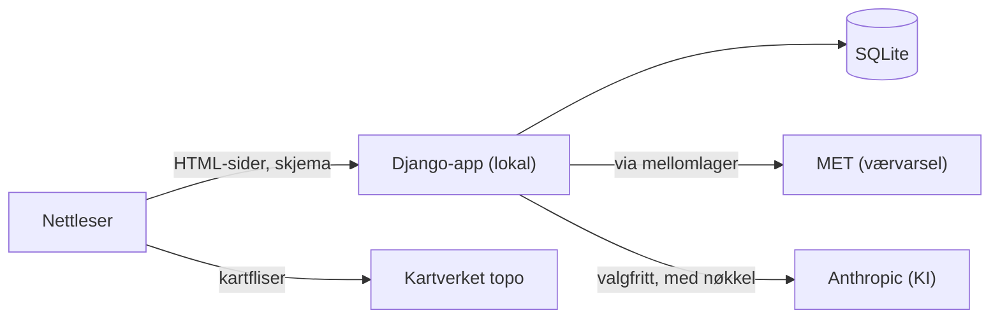
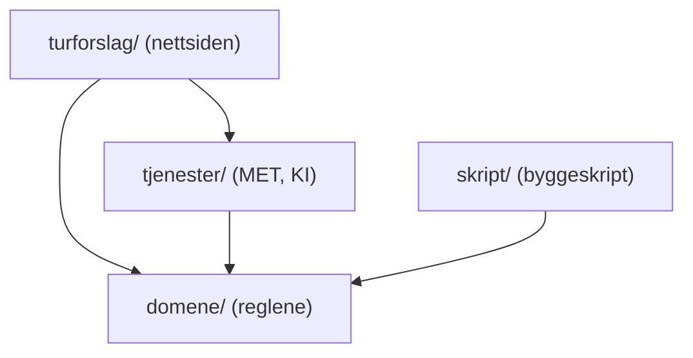
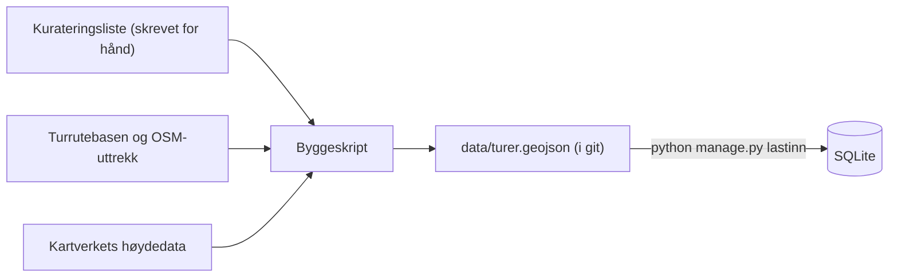
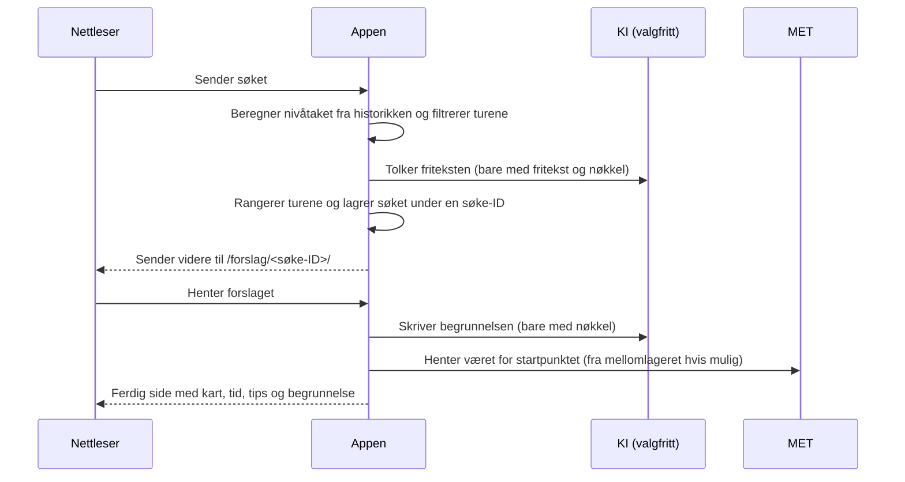

# Arkitektur: Your Next Adventure

Dette dokumentet forklarer hvordan *Your Next Adventure* er bygget opp, og hvorfor. Det er skrevet for sensor og andre lesere som vil forstå løsningen uten å lese koden.

Den bindende arkitekturen står i [ARCHITECTURE-SPINE.md](../_bmad-output/planning-artifacts/architecture/architecture-G81-eriksen-2026-11-07/ARCHITECTURE-SPINE.md). Der er hver beslutning nummerert (AD-1 til AD-14). Begrunnelsene og alternativene som ble vurdert, står i [beslutningsloggen](../_bmad-output/planning-artifacts/architecture/architecture-G81-eriksen-2026-11-07/.memlog.md). Kravene står i [PRD-en](../_bmad-output/planning-artifacts/prds/prd-G81-eriksen-2026-10-29/prd.md), og designet i [EXPERIENCE.md](../_bmad-output/planning-artifacts/ux-designs/ux-G81-eriksen-2026-11-06/EXPERIENCE.md).

## Utgangspunktet

Tre forhold styrte valgene mer enn noe annet:

1. **Sensor skal kunne kjøre appen lokalt på under 20 minutter, uten nøkler** (tilgangskoder til eksterne tjenester, NFR-1). Derfor er det ingen databaseserver, ingen Node, ingen Docker og ingen tjenester som krever innlogging for at kjerneflyten skal virke.
2. **Én utvikler uten programmeringserfaring bygger appen med hjelp av KI.** Derfor er det ett språk (Python), én prosess, ett kjent rammeverk og få verktøy. Arkitekturreglene er skrevet slik at to KI-økter som bygger hver sin del, lager deler som passer sammen.
3. **Personaliseringen skal være faste regler som kan testes** (FR-5, FR-18–20, SM-2). Derfor ligger alle reglene på ett sted, uten kobling til nettsiden eller databasen.

## Oversikt

Appen er én Django-nettside som kjører lokalt på maskinen. Nettleseren får ferdige HTML-sider fra serveren. Bare kartet og noen små forbedringer bruker JavaScript.



Turdatabasen bygges på forhånd av et eget skript, og resultatet ligger i repoet som en fil. Appen henter derfor aldri turdata fra internett mens den kjører.

## Lagene

Koden er delt i fire lag, og hvert lag er én mappe (AD-2). Mappestrukturen er altså selve arkitekturen.

| Mappe | Hva den gjør | Eksempel |
| --- | --- | --- |
| `domene/` | Alle reglene, skrevet i vanlig Python uten Django | Gradering (FR-2), estimert tid (FR-3), utvalg og rangering (FR-5), nivåregler (FR-19), sjekk av KI-svar (FR-13) |
| `turforslag/` | Nettsiden: sider, skjemaer, databasemodeller, maler, CSS og JavaScript | Søkeskjemaet, turforslaget, historikken, konto |
| `tjenester/` | Kontakten med tjenester utenfor appen | Værvarsel fra MET, KI fra Anthropic |
| `skript/` | Byggeskriptet som lager turdatabasen | Henter rutelinjer og høyder fra Kartverket |



Pilene viser hvem som får bruke hvem. `domene/` bruker ingen av de andre. Det har to fordeler:

- Reglene kan testes én og én på en brøkdel av et sekund, uten database og uten å starte nettsiden.
- Bare byggeskriptet beregner turnivå og tid, med reglene i `domene/`. Nettsiden leser de ferdige verdiene, så de kan ikke bli ulike.

## Turdatabasen

Turdatabasen lages i tre steg (AD-3):



1. **Kurateringslista** er en fil der hver tur er skrevet inn for hånd: navn, startpunkt, form, turtyper, kilde-ID og lenke til ut.no. Turnavnet skrives inn for hånd, fordi kildene ofte mangler navn («Ukjent» på 41 av 186 ruter i Oslo).
2. **Byggeskriptet** henter rutelinjen og høydene, gjør om UTM-koordinatene i kartdataene til vanlige GPS-koordinater, og beregner lengde, høydemeter, nedstigning, høydeprofil, turnivå og estimert tid. Resultatet er `data/turer.geojson`. Skriptet kjøres av utvikleren, ikke av sensor.
3. **`lastinn`** leser fila og testbrukeren inn i databasen med én kommando. Kommandoen kan kjøres flere ganger uten å slette historikken til brukerne. Bare testbrukeren lages på nytt.

OpenStreetMap brukes bare som supplement. Uttrekket er hentet én gang, har færre enn 100 objekter og er lagret for seg selv, slik at det regnes som et «uvesentlig» uttrekk etter ODbL-lisensen (se addendumet til PRD-en).

## Et søk, steg for steg



- **Søke-ID:** Hvert søk får en tilfeldig ID i adressen. ID-en virker bare i nettleseren der søket ble gjort, så forslaget kan ikke deles som lenke (FR-7, AD-5). Hver fane har sitt eget forslag, og «Nytt forslag» bruker rangeringen som allerede er lagret.
- **Uten KI-nøkkel** hopper appen over begge KI-stegene og lager begrunnelsen fra en fast mal. Slik kjører sensor appen, og hele kjerneflyten virker (SM-3).
- **Uten værvarsel** (MET svarer ikke, eller datoen er mer enn ca. 9 dager frem) vises forslaget uten bekledningstips, med en melding om at værvarselet mangler (FR-10).

## KI og personvern

KI er valgfri. Koden har tre varianter av KI-modulen: **ekte** (Anthropic), **reserve** (fast mal) og **falsk** (brukes i testene). Appen velger reserve automatisk når nøkkelen mangler.

KI kan aldri velge en tur som ikke har bestått reglene, og den skriver aldri tall eller turnivå. Den bruker plassholdere som `{tid}` og `{nivå}`, som appen fyller inn fra turdatabasen. Hvert svar sjekkes av en regel i `domene/`. Bryter et svar reglene, er det for langt, eller tar det mer enn 5 sekunder, forkaster appen svaret. Forkastes tolkingen, ser appen bort fra friteksten. Forkastes begrunnelsen, bruker appen reservemalen (FR-13).

KI får bare søket og turene som kan foreslås. E-post, bruker-ID og historikk sendes aldri (NFR-5).

Appen gjør maks 20 KI-kall per nettleser i timen og maks 200 per døgn. Over grensen brukes reservemalen, akkurat som uten nøkkel. Med ca. 0,0004 USD per kall koster et fullt døgn høyst ca. 0,08 USD (NFR-8, AD-10). Forkastede KI-svar logges lokalt med årsak, uten fritekst, e-post eller bruker-ID, og loggen slettes etter 30 dager (NFR-5).

## Personalisering

Nivåtaket er det høyeste turnivået appen foreslår for en bruker. En sperre senker nivåtaket for en tid etter en tur som var vanskelig.

Alle reglene for nivå ligger i én funksjon som går gjennom brukerens registrerte turer i rekkefølge og regner ut nivåtak, sperre, fremgang og foretrukne turtyper (FR-18–20). Søket, fremgangslinjen i historikken og begrunnelsen leser alle fra den samme funksjonen, så de kan ikke vise ulike svar.

Testbrukeren har en oppdiktet historikk som viser nivåheving, sperre og turtypepreferanse med en gang (FR-21).

## Sikkerhet og robusthet

- Passord lagres bare som hash, med Djangos standard (FR-14, AD-7).
- En bruker ser bare sine egne data. Serveren sjekker alt brukeren sender inn, og skjemaer er beskyttet mot forfalskede innsendinger (NFR-8).
- Skjemaer sender brukeren videre etter innsending, så siden kan lastes på nytt uten å sende skjemaet igjen. Registrering av en tur har i tillegg et engangsmerke, så et dobbeltklikk gir bare én registrering (AD-14, NFR-2).
- Sletting av konto skjer i én operasjon. Feiler den, slettes ingenting (FR-15).
- Innloggingen varer i to uker. Brukeren blir ikke logget ut midt i en utfylling (AD-6, NFR-4, WCAG 2.2.1).
- Nøkler ligger i `.env`, som aldri legges i git. `.env.example` virker uten endring (AD-12, NFR-1).

## Testing

Alle tester kjøres med `python manage.py test` (AD-13) og trenger verken internett eller nøkler. Reglene i `domene/` testes direkte. KI byttes ut med den falske varianten, og MET med lagrede svar. Testene viser til krav-ID-ene de dekker, for eksempel FR-19.

## Viktige valg og hvorfor

| Valg | Hvorfor | Forkastet |
| --- | --- | --- |
| **Django, én nettside der serveren lager alle sidene** (AD-1) | Ett språk og én prosess. Innlogging, skjemaer, database og sikkerhet følger med, så utvikleren skriver mindre sikkerhetskode selv | React-frontend med eget API (to språk, Node for sensor), Flask (mer må settes sammen selv), Next.js (ikke Python) |
| **SQLite** (AD-4) | Én fil, følger med Python, krever ingen installasjon | PostgreSQL (databaseserver for sensor) |
| **Turdatabase bygget på forhånd** (AD-3) | Ingen avhengighet til Kartverket når appen kjører, og like verdier hver gang | Henting av turdata mens appen kjører (utenfor omfanget i PRD-en) |
| **Kartverket topo + Leaflet** (AD-8) | Norske turkart med stier, ingen nøkkel, åpen lisens. Leaflet ligger i repoet, så ingen CDN eller npm | OpenStreetMap-fliser (bruksvilkår og mindre turdetalj) |
| **MET via eget mellomlager** (AD-9) | MET krever at nettlesere ikke kaller API-et direkte, at svar mellomlagres og at appen identifiserer seg | Kall direkte fra nettleseren (brudd på vilkårene) |
| **Claude Haiku 5.5 som KI** (AD-10) | Anthropic bruker ikke betalte API-kall til trening, så fritekst fra brukere havner ikke i treningsdata (NFR-5). Prisen er ca. 0,0004 USD per kall | Gemini gratisnivå (innholdet brukes til å forbedre Googles produkter) |
| **Nivåtaket beregnes fra historikken** (AD-11) | Nivåtaket kan aldri komme i utakt med registreringene, og testbrukeren viser reglene uten oppsett | Lagret nivåtak som oppdateres ved hver registrering |
| **Én liten JavaScript-fil i tillegg til kartet** (AD-1) | UX-designet krever at «Nytt forslag» bytter innhold uten å laste siden på nytt, og at det vises en lasteindikator. Siden virker også uten JavaScript | Bare kart-JS (avvik fra designet) |

## Teknologi

| Teknologi | Versjon |
| --- | --- |
| Python | 3.12–3.15 (testet på 3.14) |
| Django | 6.1.3 |
| SQLite | 3.37 eller nyere (følger med Python) |
| Leaflet | 1.9.4 |
| anthropic (Python-SDK) | 2.6.0, modell `claude-haiku-5-5` |
| python-dotenv | 1.2.4 |
| pyproj (bare byggeskriptet) | 3.8.0 |
| Ruff (kodestil) | 0.17.4 |

Eksterne tjenester: Kartverket topo (kartfliser), Kartverkets høyde-API (bare byggeskriptet), MET Locationforecast 2.0 og Anthropic API.

Versjonene ble sjekket mot PyPI, npm og leverandørenes dokumentasjon 2026-11-08.

## Mappestruktur

```text
G81-eriksen/
  manage.py, requirements.txt, requirements-bygg.txt, pyproject.toml, .env.example, README.md
  config/        Django-innstillinger
  turforslag/    nettsiden: sider, skjemaer, modeller, maler, CSS og JavaScript
  domene/        reglene, ren Python
  tjenester/     MET og KI
  data/          kurateringsliste, OSM-uttrekk, turer.geojson, testbruker
  skript/        byggeskriptet for turdatabasen
  tests/         automatiske tester
  docs/          dette dokumentet og andre vedlegg
```

## Hva som ikke er med i v1

- Appen publiseres ikke på internett. Den kjøres lokalt etter README.
- E-post og tilbakestilling av passord er ikke med.
- Turer utenfor Oslo og Bærum er ikke med.
