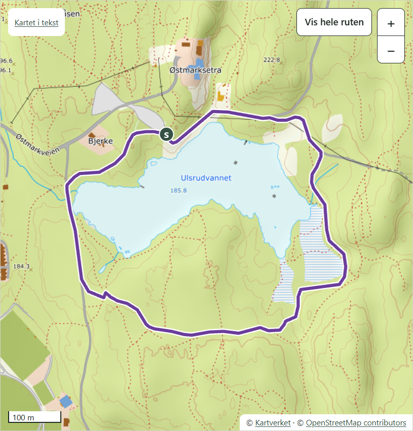
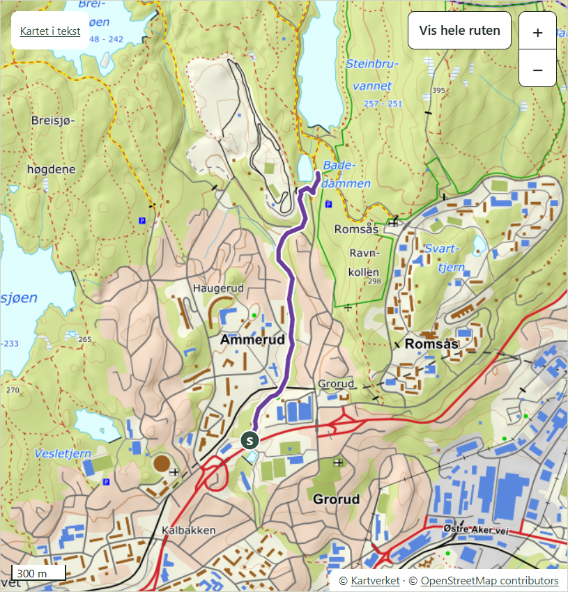

# Kartfargene mot Kartverkets fliser

Måling av kartlag-fargene `map-route`, `map-marker-start` og `map-focus-ring` mot ekte topo-fliser fra Kartverket i skog, myr, vann og bebyggelse (story 6.5, UX-DR35, NFR-4, NFR-7, UX-DR1). Resultatet erstatter de antatte flisfargene og OSM-stedfortrederne i Kontrastmål i [DESIGN.md](../_bmad-output/planning-artifacts/ux-designs/ux-G81-eriksen-2026-11-06/DESIGN.md).

## Slik er målingen gjort

- **Fliser:** AR-10-adressen som kartet bruker, `https://cache.kartverket.no/v1/wmts/1.0.0/topo/default/webmercator/{z}/{y}/{x}.png`. Adressen har raden (`y`) før kolonnen (`x`), men tabellene under oppgir flisene som `z/x/y`.
- **Steder og zoom:** to steder for hver flate, i eller ved turområdene, på zoom 13 og 15. `fitBounds` gir turene zoom 11–16, og 13 og 15 dekker det spennet. Vann: Sognsvann og Nøklevann. Skog: Nordmarka og Østmarka. Myr: ved Fuglemyrhytta og i Lillomarka. Bebyggelse: Grorud og Gjettum. Det blir 16 fliser.
- **Skript:** [`skript/mal_kartfarger.py`](../skript/mal_kartfarger.py), som bare bruker standardbiblioteket. Det henter flisene til en midlertidig mappe, leser pikslene med en egen PNG-leser, leser tokenverdiene fra `turforslag/static/css/tokens.css` og skriver tabellene. Tabellene under bygger på utskriften; symboltabellen er redigert (overskriften er forkortet og vannflate-raden lagt til). Kjør det igjen med `venv/Scripts/python.exe -m skript.mal_kartfarger`. Det avslutter med kode 1 hvis et krav ikke holder. Testene ligger i `tests/skript/test_mal_kartfarger.py` og bruker ikke nett.
- **Hva som er flaten:** topo-flisene skyggelegger terrenget ved å trekke omtrent like mye fra alle tre fargekanalene. Fargetonen `(g − r, r − b)` er derfor den samme i lys og skygge. En piksel hører til flaten når tonen er innenfor ±1 av flatens lyseste, uskyggede farge, og den er høyst 96 trinn mørkere. Grunnfargene er skog `#DFEDA3`, vann `#E0FEFE`, myr `#FEFEFE`, boligfelt `#FBE4D0` og bebygd (grå) `#FEFEED`.
- **Myr** er hvit flate med blå skravur. Flaten er den hvite. Hvitt har samme tone som grå og svart tekst, så for myr telles bare piksler der alle fire naboene også er hvit flate, med høyst 4 trinns forskjell. Det tar bort kantene rundt tekst og streker.
- **Bebyggelse** er målt som to flater: boligfelt (`#EAD3BF`-tonen) og grå bebygd flate.
- **Symboler er ikke flater.** Blå bygninger, røde og svarte veier og stier, koter og tekst har andre toner og telles ikke. De vurderes for seg under [Ruten mot stier, veier og vann](#ruten-mot-stier-veier-og-vann).
- **Typisk og mørkest:** for hver flis oppgis den vanligste pikselen (typisk) og 1. persentil av relativ luminans (mørkest). Skyggeleggingen gjør skogen 10–20 % mørkere i bratte lier, så den typiske fargen alene ville overvurdere kontrasten. I kontrasttabellen er «mørkest» den mørkeste 1. persentilen blant flisene for flaten, og «typisk» er den typiske fargen fra flisen med flest piksler av flaten. **Kravet gjelder den mørkeste.** Det er et bevisst valg, ikke det absolutte minimum: om lag 1 % av skogpikslene på den mørkeste flisen er enda mørkere (ned til `#92A056`).
- **Kontrast:** WCAG 2.1 relativ luminans. Tallene er rundet **ned** til to desimaler, fordi WCAG ikke runder opp til kravet.
- **Ingen ny pakke** i `requirements.txt` eller `requirements-dev.txt`, og ingen endring i CSP, `kart.js` eller maler.

Målt 2026-11-26 av Claude. Hannah bekrefter i PR-en.

## Flisene

«Piksler» er hvor mange av flisens 256 × 256 piksler som er flaten. Myr-flekkene er små på disse flisene, og på zoom 13 i Lillomarka er det bare 17 indre hvite piksler. Med så få piksler er 1. persentil der den mørkeste pikselen. Den hvite flaten er så lys at kontrasten likevel er god (se under).

| Flis (`z/x/y`) | Sted | Flate | Piksler | Typisk | Mørkest (1. persentil) |
|---|---|---|---|---|---|
| `13/4340/2380` | Sognsvann | vann | 3598 | `#E0FEFE` | `#E0FEFE` |
| `15/17360/9520` | Sognsvann | vann | 38125 | `#E0FEFE` | `#E0FEFE` |
| `13/4343/2384` | Nøklevann | vann | 7028 | `#E0FEFE` | `#E0FEFE` |
| `15/17373/9536` | Nøklevann | vann | 5112 | `#E0FEFE` | `#E0FEFE` |
| `13/4339/2378` | Nordmarka | skog | 50539 | `#D2E096` | `#B5C378` |
| `15/17357/9513` | Nordmarka | skog | 59257 | `#D8E69C` | `#C5D389` |
| `13/4343/2383` | Østmarka | skog | 47172 | `#DFEDA3` | `#A1AF65` |
| `15/17375/9535` | Østmarka | skog | 58211 | `#DFEDA3` | `#9BA95F` |
| `13/4339/2379` | ved Fuglemyrhytta | myr (hvit flate) | 136 | `#F1F1F1` | `#EBEBEB` |
| `15/17357/9518` | ved Fuglemyrhytta | myr (hvit flate) | 174 | `#F2F2F2` | `#EDEDED` |
| `13/4342/2379` | Lillomarka | myr (hvit flate) | 17 | `#EDEDED` | `#EAEAEA` |
| `15/17371/9518` | Lillomarka | myr (hvit flate) | 165 | `#F1F1F1` | `#EBEBEB` |
| `13/4343/2380` | Grorud | boligfelt | 11168 | `#EDD6C2` | `#D0B9A4` |
| `13/4343/2380` | Grorud | bebygd (grå) | 10601 | `#F1F1E0` | `#D9D9C9` |
| `15/17374/9522` | Grorud | boligfelt | 18028 | `#F0D9C5` | `#DFC8B3` |
| `15/17374/9522` | Grorud | bebygd (grå) | 19550 | `#EEEEDD` | `#E3E3D2` |
| `13/4335/2383` | Gjettum | boligfelt | 21584 | `#FBE4D0` | `#C9B29E` |
| `13/4335/2383` | Gjettum | bebygd (grå) | 9280 | `#F1F1E0` | `#D0D0BF` |
| `15/17342/9532` | Gjettum | boligfelt | 24875 | `#EAD3BF` | `#D9C2AE` |
| `15/17342/9532` | Gjettum | bebygd (grå) | 5427 | `#F0F0DF` | `#A9A999` |

Vannflaten er ikke skyggelagt, så typisk og mørkest er like. Den mørkeste skogen er på zoom 15 i Østmarka (`#9BA95F`), og den mørkeste grå bebygde flaten er på zoom 15 ved Gjettum (`#A9A999`). Begge er skyggelagte lier.

## Kontrast

Første tall er mot den mørkeste varianten (kravet), andre mot den typiske. Kravet er 3,0 for alle tre tokenene (WCAG 1.4.11). Ruten måles rett mot flisene fordi AC-ene i story 6.5 krever at `map-route` har minst 3:1 mot alle flatene og den hvite kanten, mens fokusringen måles mot hvitt etter beslutning 1A og 5 i [spec-en for story 6.5](../_bmad-output/implementation-artifacts/spec-6-5-kartfargene-er-malt-mot-ekte-kartfliser.md).

| Flate | Mørkest / typisk | `map-route` | `map-marker-start` | `map-focus-ring`¹ |
|---|---|---|---|---|
| hvit kant (`map-overlay-surface`) | `#FFFFFF` | **7,98** | **8,68** | **4,47** |
| vann | `#E0FEFE` / `#E0FEFE` | 7,52 / 7,52 | 8,18 / 8,18 | 4,21 / 4,21 |
| skog | `#9BA95F` / `#D8E69C` | 3,13² / 5,97 | 3,40 / 6,50 | 1,75 / 3,35 |
| myr (hvit flate) | `#EAEAEA` / `#F2F2F2` | 6,64 / 7,13 | 7,22 / 7,76 | 3,72 / 3,99 |
| boligfelt | `#C9B29E` / `#EAD3BF` | 3,93 / 5,54 | 4,28 / 6,02 | 2,20 / 3,10 |
| bebygd (grå) | `#A9A999` / `#EEEEDD` | 3,35 / 6,81 | 3,65 / 7,41 | 1,88 / 3,81 |

Alle kravene holder, og skriptet avslutter med kode 0.

¹ **Fokusringen måles mot sin hvite ytre kant** (beslutning 1A, 2026-11-26, i [spec-en](../_bmad-output/implementation-artifacts/spec-6-5-kartfargene-er-malt-mot-ekte-kartfliser.md)). På kartflaten har ringen 3 px hvitt på begge sider: en hvit ytre kant og et hvitt indre bånd (`side.css`, `.kart .kart-flate:focus-visible::after`, beslutning 5). På kontrollene og lenkene ligger ringen mellom hvit knapp eller flate inni og hvit `box-shadow` utenfor. Nabofargene er derfor hvite, og kravet i WCAG 1.4.11 gjelder ringen mot hvitt: 4,47. Tallene rett mot flatene står bare til informasjon, fordi ringen aldri ligger rett på flisen.

² Med den nye rutefargen `#673A97`. Se [Rutefargen ble justert](#rutefargen-ble-justert).

### Startmarkøren mot «S»

«S» i startmarkøren er hvit tekst (`map-overlay-surface`) på `map-marker-start`: **8,68** (krav 4,5). Markøren har i tillegg 2 px hvit kant, og den holder minst 3,40 mot alle flatene.

## Rutefargen ble justert

Målingen fant **2,998** mellom den forrige rutefargen `#6A3D9A` og den mørkeste skogen (`#9BA95F`, 1. persentil på flisen `15/17375/9535` i Østmarka), like under 3,0. Alle andre par holdt kravet. `map-route` ble derfor justert til **`#673A97`**, samme plommelilla (tone 269°), men litt mørkere. Den gir 3,13 mot den mørkeste skogen og 7,98 mot den hvite kanten. Justeringen godkjennes av produkteier i PR-en (beslutning 4 i [spec-en](../_bmad-output/implementation-artifacts/spec-6-5-kartfargene-er-malt-mot-ekte-kartfliser.md)). Tokenet er endret bare i `DESIGN.md` (frontmatter, Kartlag og Kontrastmål) og `tokens.css`.

## Ruten mot stier, veier og vann

Fargene er lest ut av de samme flisene. Fargetonen er i grader (HSV). Ruten har tone 269°.

| Symbol | Farge | Fargetone | Kontrast mot `map-route` |
|---|---|---|---|
| sti og vei, rød | `#D2232A` | 358° | 1,52 |
| vei, oransje | `#D68723` | 34° | 2,79 |
| vei, gul | `#FAEB00` | 56° | 6,44 |
| kote, brun | `#D8A97D` | 29° | 3,76 |
| bekk og myrskravur, blå | `#9ACBE7` | 202° | 4,59 |
| vannskrift, blå | `#005CE6` | 216° | 1,39 |
| bygning, blå | `#5A87DE` | 220° | 2,26 |
| løype, grønn | `#00CC00` | 120° | 3,66 |
| vannflate | `#E0FEFE` | 180° | 7,52 |

**Vurdering:** ruten skiller seg tydelig ut fra stier, veier, vann og bebyggelse, både i tallene og på skjermbildene under.

- **Stier** er røde og stiplede, og **veier** er røde, grå eller svarte. Ruten er plommelilla (269°, 89° fra den røde), heltrukket, 5 px bred og ligger på en 9 px hvit kant. Mot den røde stien er lyshetskontrasten lav (1,52), så det er fargetonen, bredden og den hvite kanten som skiller dem. For protanopi og deuteranopi kan rød sti og plommelilla rute ligne i fargetone, men ruten skilles likevel av den hvite kanten, bredden og heltrukket mot stiplet linje. På skjermbildene er ruten lett å følge der den krysser og går langs stier og veier.
- **Vann** er lyseblå flate (7,52 mot ruten), og bekker og myrskravur er lyseblå og tynne (4,59). Ruten langs Ulsrudvann skiller seg tydelig fra vannet.
- **Bebyggelse** er lys flate (3,93 og 3,35 mot den mørkeste skyggen). Ved Grorud er ruten tydelig mot boligfeltene og de røde veiene.
- Den mørkeblå vannskriften og de blå bygningene ligger 49–53° fra ruten og er tekst og små flater, ikke linjer. Nivåfargen Blå brukes ikke på kartet.

## Før og etter

Skjermbildene er tatt i Chrome på Turforslag, med «© Kartverket» synlig i krediteringen. «Før» har den forrige rutefargen `#6A3D9A`, og «etter» har `#673A97`. Forskjellen er knapt synlig, slik den skal være.

**Rundtur Ulsrudvann:** vann, skog, myr med skravur, stier og Østmarksetra.

**Grorud:** bebyggelse, røde veier, stier og Badedammen.

